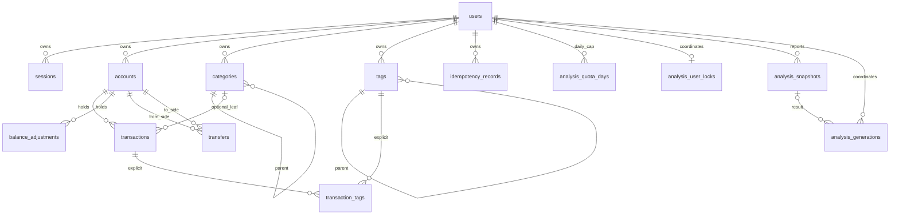

# 04丨记账软件｜v1.0 统一数据库物理设计 Review v0.1

- 状态：**Review / Pending Approval**
- 日期：2026-10-26
- 性质：一次性 v1.0 物理设计审阅。不是下一业务 Stage 计划，不批准 DDL，不授权连接业务库执行。
- 来源提交：`8012a9ef262d2504c1da46f1bea6ddd25af55ac9`。审阅开始时 `origin/release/v1.0` 与该提交相同。
- 正文 SHA-256 不写入本文，避免自引用改变校验值。交付回执给出定稿 SHA。

## 0. 依据与边界

| 资料 | SHA-256 或提交 | 用法 |
|---|---|---|
| 治理 v1.8 §4.10 | 仓库外文件 `a8fb22ac207e06be3341826be5690d91b7c7f6d74e81937b26e5a2cb0bd987b0` | S3 CLOSED 之后、下一 Stage Coding 之前做一次终态评审。评审通过不自动授权 DDL。 |
| 批准记录 | `6fa905d8697eeb555072a0cd740cefcdca8e8f31d2729c74169d33bb328223ea` | 只说明这次评审已经获准开展。 |
| Product Baseline | `b41d4305eabb9f12ed62f112e90ae5074d3235eb1b509bce4a6106cd12c9063c` | 冻结 P0。 |
| UI Freeze | `791a09b7acb291fb75bd93420500c7c0b15ececcec457cdd10588295f0dbc04a` | 不改变导航和视觉。本文不改 UI。 |
| S3 结项 | `a994388ea67e8d04b21bdfa6d5b2228790a50ec4937ed670de27f831ce793203` | S3 已 CLOSED。 |
| S3 只读准备 | `304d23c650682e7551c352a275b0c288f7f8a99e32e4b0bad97bf1aeda551c3f` | 日常库于 2026-10-25 20:33:21 记下 V17。本审阅没有再次连接数据库。 |

物理结构以仓库内 Flyway V1–V17 和当前 Java 映射、Repository、JdbcClient SQL 为准。v0.1 数据模型里仍写着标签 `type` 和按父节点唯一的分类名，那份文档不代表当前表。

本轮没有执行计划（EXPLAIN）。凡是“可能有用”的新索引都标成未验证候选，不进入建议 DDL。

负责人已认可的逻辑关系保持不变：用户、账户、普通交易、转账、余额调整、分类、标签、交易标签关联是独立事实；余额、净值和统计是派生结果；AI 月报和年报优先复用现有快照与生成记录；不引入 Redis、MQ，不提前做延期功能。

## 1. 逻辑 ER

派生值不建表：当前账面余额、历史时点余额、账本净值、分类汇总、标签汇总。它们由 `accounts.opening_balance` 加上交易、转账两侧和余额调整按各自业务时间计算。

## 2. 当前物理清单

以下是 V1–V17 叠加后的终态。删除未写出 `ON DELETE` 的外键，MySQL 默认为 RESTRICT。用户隔离指业务查询是否带 `user_id`，以及外键是否把子行绑在同一用户的父行上。

### 2.1 `users` 用户 / 身份

| 列 | 类型 | 空 |
|---|---|---|
| `id` | BIGINT AI | 否 |
| `username` | VARCHAR(100) | 否 |
| `password_hash` | VARCHAR(255) | 否 |
| `created_at_utc` / `updated_at_utc` | DATETIME(6) | 否 |

主键 `id`。唯一 `uk_users_username (username)`。无外键。实现状态：JPA `UserEntity`。没有手机号、注销或合并列。

### 2.2 `sessions` 会话 / 身份

主键 `id`。唯一 `uk_sessions_token_hash (token_hash BINARY(32))`。外键 `user_id -> users.id`。索引 `idx_sessions_user (user_id)`、`idx_sessions_expires (expires_at_utc)`。JPA `SessionEntity`。

### 2.3 `accounts` 资金账户 / 账户

| 列 | 类型 | 空 | 来源 |
|---|---|---|---|
| `id` | BIGINT AI | 否 | V3 |
| `user_id` | BIGINT | 否 | V3 |
| `name` | VARCHAR(64) | 否 | V3 |
| `kind` | VARCHAR(16) | 否，默认 NORMAL | V12。CHECK `NORMAL` / `CREDIT` |
| `currency` | CHAR(3) | 否 | CHECK 只能是 `CNY` |
| `opening_balance` | DECIMAL(19,2) | 否 | V3 |
| `created_time` | DATETIME(0) | 否 | V3 |
| `last_first_save_order` | BIGINT | 否，默认 0 | CHECK `>= 0` |
| `lifecycle` | VARCHAR(16) | 否，默认 ACTIVE | V15。CHECK `ACTIVE` / `ARCHIVED` |
| `updated_at_utc` | DATETIME(6) | 否 | V3 |

主键 `id`。唯一 `uk_accounts_id_user (id, user_id)`、`uk_accounts_user_name (user_id, name)`。外键 `user_id -> users.id`。V12 已删除一用户一账户的 `uk_accounts_user`。JPA `AccountEntity`。没有额度上限列。

### 2.4 `categories` 分类 / 分类树

| 列 | 类型 | 空 |
|---|---|---|
| `id` | BIGINT AI | 否 |
| `user_id` | BIGINT | 否 |
| `type` | VARCHAR(16) | 否。CHECK `INCOME` / `EXPENSE` |
| `name` | VARCHAR(100) | 否 |
| `parent_id` | BIGINT | 是 |
| `parent_scope_id` | BIGINT 生成列 | 否。`COALESCE(parent_id, 0)` STORED |
| `created_at_utc` | DATETIME(6) | 否 |

主键 `id`。唯一 `uk_categories_id_user_type (id, user_id, type)`、`uk_categories_user_type_name (user_id, type, name)`。V17 删除了 `uk_categories_scope_name`，生成列还在。外键 `user_id -> users.id`；`fk_categories_parent (parent_id) -> categories(id)`，只按 id，不按用户。索引 `idx_categories_user_type (user_id, type)`、`idx_categories_parent (parent_id)`。JPA `CategoryEntity`。深度、成环、已有直接交易不能再当父节点，都在 `CategoryService`，没有触发器。

### 2.5 `tags` 标签 / 标签树

V17 之后的列：`id`、`user_id`、`name VARCHAR(100)`、`created_at_utc DATETIME(6)`、`parent_id BIGINT NULL`。`type`、`ck_tags_type`、`idx_tags_user_type` 已删除。

主键 `id`。唯一 `uk_tags_user_name (user_id, name)`、`uk_tags_id_user (id, user_id)`。外键 `user_id -> users.id`；`fk_tags_parent (parent_id, user_id) -> tags(id, user_id)`。索引 `idx_tags_parent_user (parent_id, user_id)`。JPA `TagEntity` 不再映射 `type`。深度和成环在 `TagService`。

S3 只读证据：2026-10-25 日常库 `tags` 列与此一致，Flyway 17 且 `success=1`。`account_id IS NULL` 的分析行数量当时没有查，本文不猜测。

### 2.6 `transactions` 普通交易 / 账务

| 列 | 类型 | 空 |
|---|---|---|
| `id` | BIGINT AI | 否 |
| `user_id` / `account_id` | BIGINT | 否 |
| `type` | VARCHAR(16) | 否。CHECK `INCOME` / `EXPENSE` |
| `amount` | DECIMAL(19,2) | 否。CHECK `<> 0` |
| `name` | VARCHAR(255) | 是 |
| `category_id` | BIGINT | 是。V10 改为可空 |
| `business_time` | DATETIME(0) | 否 |
| `first_saved_at_utc` | DATETIME(6) | 否 |
| `first_save_order` | BIGINT | 否。CHECK `> 0` |
| `updated_at_utc` | DATETIME(6) | 否 |
| `remark` | TEXT | 是 |

主键 `id`。V13 删除了 `uk_transactions_account_order`，跨账户移动可以保留原来的 `first_save_order`。外键 `fk_transactions_account (account_id, user_id) -> accounts(id, user_id)`；`fk_transactions_category (category_id, user_id, type) -> categories(id, user_id, type)`。索引：

- `idx_transactions_ledger (account_id, business_time, first_save_order)`
- `idx_transactions_month_type (account_id, type, business_time)`
- `idx_transactions_category_month (account_id, category_id, business_time)`

JPA `TransactionEntity`。

### 2.7 `transaction_tags` 交易标签关联 / 关联

主键 `(transaction_id, tag_id)`。外键：交易 `ON DELETE CASCADE`；标签 `ON DELETE RESTRICT`。索引 `idx_transaction_tags_tag (tag_id, transaction_id)`。没有 `user_id`。删除叶子标签时，服务先按 `tag_id` 且 `transactions.user_id` 删除关联行，再删标签。JPA `TransactionTagEntity`。

### 2.8 `balance_adjustments` 余额调整 / 账务

列：`id`、`user_id`、`account_id`、`adjustment_amount DECIMAL(19,2) <> 0`、`business_time DATETIME(0)`、`first_saved_at_utc`、`first_save_order > 0`、`remark`。主键 `id`。唯一 `uk_adjustments_account_order (account_id, first_save_order)` 仍在。外键 `(account_id, user_id) -> accounts(id, user_id)`。索引 `idx_adjustments_ledger (account_id, business_time, first_save_order)`。不关联分类或标签。JPA `BalanceAdjustmentEntity`。

### 2.9 `transfers` 转账 / 账务

列：`id`、`user_id`、`from_account_id`、`to_account_id`、`amount DECIMAL(19,2) > 0`、`from_business_time`、`to_business_time`、`first_saved_at_utc`、`first_save_order > 0`、`updated_at_utc`。两侧账户必须不同。两侧外键都是 `(account_id, user_id) -> accounts(id, user_id)`，RESTRICT。索引：

- `idx_transfers_from_account_user (from_account_id, user_id)`
- `idx_transfers_to_account_user (to_account_id, user_id)`
- `idx_transfers_from_ledger (from_account_id, from_business_time, first_save_order)`
- `idx_transfers_to_ledger (to_account_id, to_business_time, first_save_order)`

没有 `(account_id, first_save_order)` 唯一约束。JPA `TransferEntity`。

### 2.10 `idempotency_records` 幂等记录 / 技术

主键 `id`。唯一 `(user_id, scope, operation_id)`。外键 `user_id -> users.id`。索引 `idx_idempotency_created (created_at_utc)`。JPA `IdempotencyRecord`。

### 2.11 `analysis_snapshots` 分析快照 / AI

V11 建表，V14 增加可空 `account_id`。列包括 `analysis_month CHAR(7)`、`context_fingerprint VARCHAR(128)`、四段报告正文、模型与 token、`permit_date`、`generated_at_utc`。成功快照只插入，不更新。

索引 `idx_analysis_snapshots_scope`、`idx_analysis_snapshots_month` 仍是不含 `account_id` 的用户+月键。V14 另加 `idx_analysis_snapshots_account_scope (user_id, account_id, analysis_month, context_fingerprint, id)` 和 `idx_analysis_snapshots_account_month (user_id, account_id, analysis_month, id)`。外键 `user_id -> users.id`；`(account_id, user_id) -> accounts(id, user_id)`。`account_id` 为 NULL 时 MySQL 不检查这组外键。注释写明 NULL 是无法归属的旧行，不是全账本。没有 JPA 实体，使用 `JdbcAnalysisGenerationStore`。

### 2.12 `analysis_quota_days` 每日调用额度 / AI

主键 `(user_id, permit_date)`。`reserved_count`、`consumed_count` 非负，且两者之和 `<= 3`。外键 `user_id -> users.id`。应用常量 `DAILY_SUCCESS_LIMIT = 3`，时区 `Asia/Shanghai`。这是用户级日限额，不按账户拆开。

### 2.13 `analysis_generations` 生成协调 / AI

V14 后的协调唯一键是 `uk_analysis_generations_account_scope (user_id, account_id, analysis_month, context_fingerprint)`。旧的不含账户的唯一键已删除。另有同列普通索引。状态 CHECK：`IN_PROGRESS` / `FAILED` / `SUCCEEDED`。`fencing_token > 0`。外键指向用户、快照，以及 `(account_id, user_id) -> accounts`。租约 3 分钟。同一用户的并发通过 `analysis_user_locks` 上的插入或更新串行化，不使用 Redis。

### 2.14 `analysis_user_locks` 分析用户锁 / AI

只有 `user_id` 主键，外键到 `users`。每个用户一行。

### 2.15 `flyway_schema_history` 迁移历史 / 技术

Flyway 自己的表。业务设计不改它，也不重写 V1–V17。

## 3. 查询与索引

没有 EXPLAIN。下表的“可复用”只表示现有索引的最左列与当前 SQL 的过滤、排序前缀一致。

| 查询 | 当前 SQL 形状 | 现有索引 | 结论 |
|---|---|---|---|
| 账户流水 | `account_id + user_id`，再按业务时间、首次保存顺序、保存时刻、种类、id 排序 | 交易、调整、转出、转入四条 `(账户, 业务时间, first_save_order)` | 可复用前三个排序键的前缀。`first_saved_at_utc` 和 `kind` 不在索引里，可能 filesort。单账户流水不因此新增索引。 |
| 普通交易按类型和时间 | `account_id + user_id + type + business_time` | `idx_transactions_month_type` | 可复用。 |
| 普通交易按分类 | `account_id + category_id + business_time`；删除分类时 `user_id + category_id` | `idx_transactions_category_month`；分类外键 `(category_id, user_id, type)` | 可复用。 |
| 转账两侧流水和余额 | 转出账户用 `from_business_time`，转入账户用 `to_business_time` | 四条转账索引 | 与 PRD 两侧时间一致，可复用。 |
| 当前账面余额 | 按账户对交易、调整、转账两侧做 `SUM`，不看业务时间 | 外键和账户前缀索引 | 可复用。不建余额表。 |
| 历史时点净值 | 同一套 `SUM`，加上 `business_time <= 截止点`；转账两侧各自截止 | 上述流水索引的时间范围 | 可复用。全账本净值是对每个账户各算一次再相加，仍不建事实表。 |
| 分类三级下钻 | 先读 `categories WHERE user_id AND type`，再按分类 id 汇总金额 | `idx_categories_user_type`、`idx_categories_parent` | 索引够用。当前统计只把根和直接子节点卷起来，三级叶子不会自动进根汇总。这是查询实现缺口，不是缺索引。 |
| 标签后代去重 | 现查询按每个标签自己的 `transaction_tags` 行分组 | `idx_tags_parent_user`、`idx_transaction_tags_tag` | 走子树、按交易 id 去重可以沿这两条索引做。当前 SQL 没有做 PRD ST-09。不新增索引。 |
| AI 单账户自然月 | `user_id + account_id + analysis_month`，可再加 fingerprint | `idx_analysis_snapshots_account_month`、`idx_analysis_snapshots_account_scope`、生成表同形唯一键 | 这条路径可复用。 |
| AI 全账本自然月/年 | PRD 要求一份报告覆盖未永久删除的全部账户，含归档；期间是自然月或自然年 | 没有对应列和唯一键 | 不能靠再加一条账户月索引解决。见第 5 节。 |
| 调用幂等与日限额 | 生成行唯一键加 `analysis_quota_days` 主键，限额检查在更新语句里 | 已有 | 日限额表原样复用。幂等键今天只覆盖“某账户的某月”。 |

未验证、本轮不添加的候选：

- `transactions (user_id, business_time)` 或 `(user_id, type, business_time)`。只有全账本扫描被证明比“按账户循环使用现有索引”更差时才考虑。
- 把流水索引扩展到 `first_saved_at_utc`。没有慢查询证据。
- 删除 `analysis_snapshots` 上 V11 留下的、不含 `account_id` 的两套旧索引。它们可能冗余，但是否删除要等隔离库看过执行计划和写入成本。现在删会扩大这次 DDL。

## 4. 终态判断

### 4.1 原样复用

`users`、`sessions`、`accounts`、`categories`、`tags`、`transactions`、`transaction_tags`、`balance_adjustments`、`transfers`、`idempotency_records`、`analysis_quota_days`、`analysis_user_locks`，以及分析四表里已经存在的正文列、租约、fencing token 和每日 3 次限额。

核心事实表的 id、金额小数、业务时间到秒、同用户账户外键，都不在这次终态里推翻。分类父外键仍只引用 `categories(id)`，标签父外键保持同用户复合键。这是已上线的 V17 选择。没有新的交叉用户缺陷证据时，不把分类父外键再改成复合键。`parent_scope_id` 虽已不参与唯一约束，删除它会重建被交易引用的 `categories`，不作为 P0。

### 4.2 只需改业务逻辑，不改表

- 分类统计按最新树把三级叶子卷到祖先，并保留未分类。
- 标签统计按“选中标签及其全部后代”取交易并集，再按交易 id 去重。父标签金额不把同一笔交易加两次。
- 历史时点净值继续用现有流水索引按账户计算，不建净值快照。
- 当前账面余额继续无视业务时间，把已保存的未来记录算进去。
- 归档账户仍参与全账本统计和 AI 输入；永久删除仍走现有应用层删除，不改外键策略。

### 4.3 有证据的必要 Schema 增量

只有 AI 报告的范围和期间。

证据：

- PRD AI-01：一份报告覆盖该用户全部未永久删除账户，必须包含已归档账户，不能做成几个自选账户或继续按单账户出报告。
- PRD AI-02：期间只能是一个自然月或一个自然年。
- 当前存储和 `JdbcAnalysisGenerationStore` 的方法签名都要求具体 `accountId`，查找键是 `user_id + account_id + analysis_month + context_fingerprint`。
- `account_id` 的 NULL 已被 V14 定义为归属不明的旧行，不能再拿来表示全账本。
- `analysis_month CHAR(7)` 和 `YearMonth` 解析不能直接代表“2025 全年”。
- 日限额已经是用户级，不需要新的额度表。四段报告正文可以继续装月报和年报，不必为年报新建事实表。

因此终态仍是现有四张分析表，只给快照和生成协调补上范围与期间。额度锁表不动。

### 4.4 延期，不进入本次 DDL

| 项 | 原因 |
|---|---|
| 信用额度上限列 | PRD AC-03 是 P2，可延后。 |
| 手机号登录、账号合并、注销 | PRD 明确不是当前 P0。 |
| 审计日志、监控表、多端投影 | 治理和 Backlog 都延期。 |
| 每笔流水的交易后余额列 | UAT-03，会把派生值写成事实。 |
| Redis、MQ、闭包表、触发器 | 与已确认方向相反。 |
| 重写 V1–V17 或清空重建 | §4.10 禁止。 |

## 5. 最小增量 DDL 草案

状态：草案，未批准，不是 Flyway 文件。批准前不得执行，也不得对日常库试跑。

目标表只限 `analysis_snapshots` 和 `analysis_generations`。两表使用同一组新列。

建议列：

| 列 | 类型 | 含义 |
|---|---|---|
| `report_scope` | VARCHAR(16) NOT NULL | `ACCOUNT` 单账户旧报告；`LEGACY` 是 V14 无法归属的 NULL 账户行；`LEDGER` 是新的全账本报告 |
| `period_kind` | VARCHAR(16) NOT NULL | `MONTH` 或 `YEAR` |
| `scope_account_key` | BIGINT STORED | `LEDGER` 固定 0；`ACCOUNT` 取 `account_id`；`LEGACY` 取 `-id`。0 不是自增账户 id |

约束：

- `ACCOUNT` 必须有 `account_id`；`LEDGER` 和 `LEGACY` 的 `account_id` 必须为空。
- `MONTH` 的 `analysis_month` 保持 `YYYY-MM`。`YEAR` 使用四位年份，仍放在现有 `analysis_month` 列，避免再加一张期间表。应用层只有 `period_kind=MONTH` 时才按 `YearMonth` 解析。
- 新唯一键：`(user_id, scope_account_key, period_kind, analysis_month, context_fingerprint)`。
- 新查找索引：`(user_id, report_scope, period_kind, analysis_month, id)`。
- 旧的账户月唯一键在新唯一键可用之后删除。旧的两套不含 `account_id` 的快照索引本轮保留。
- `(account_id, user_id)` 外键保留。全账本行的 `account_id` 为空，MySQL 会跳过该外键检查，所以必须靠上面的 CHECK 防止把空账户写成 `ACCOUNT`。

现有行的填充顺序：

1. 先加可空 `report_scope`、`period_kind`。
2. `account_id IS NULL` 的行写成 `LEGACY`，其余写成 `ACCOUNT`。`period_kind` 全部写成 `MONTH`。
3. 再改为非空并加 CHECK 和生成列。
4. 建新唯一键，确认成功后删除旧账户月唯一键。

`LEGACY` 使用 `-id`，是为了不把多条无法归属的旧行压成一行。MySQL 唯一索引对 NULL 的处理本来就不能靠旧键证明这些行没有重复。压缩或删除它们不在本草案里。

日限额、用户锁、快照只插入、fencing token 和 3 分钟租约都保持原语义。一次全账本月报或年报仍消耗用户当天 3 次里的 1 次。重复打开同一份已生成报告不新增调用。

### 5.1 兼容

- 旧的单账户月报行继续可读，`report_scope=ACCOUNT` 且 `period_kind=MONTH`。
- 归属不明的旧行变成 `LEGACY`，现有“必须带 accountId”的查询仍然看不到它们。
- 新的全账本报告使用 `LEDGER`。它不替换、不删除任何账户月报。
- 业务记账表、分类、标签、转账和余额调整没有数据迁移。
- 历史 Flyway 文件保持原字节。若批准，这会是一份新的 V18，而不是修改 V11 或 V14。

### 5.2 锁与影响

`analysis_snapshots` 被 `analysis_generations.snapshot_id` 引用。加生成列和替换唯一键在 MySQL 8.4 上是否能 INPLACE，本文不声称已经验证。隔离演练前按可能发生表复制来准备。记账交易表不在这组语句里。演练时保持 `foreign_key_checks=1`。不允许为了让 ALTER 变成 INPLACE 而关闭外键检查。

### 5.3 验证与恢复

批准后的验证只在明确点名的隔离库上进行，不使用这份草案直接打日常库。

验证：

- 演练前记录该库 Flyway 版本、两张分析表的行数，以及 `account_id IS NULL` 的行数。这个行数目前是**待核对**，不能用开发机上一次只读查询里没出现的数字填上。
- 迁移后：旧账户月报仍能按原账户和 `YYYY-MM` 找到；`LEGACY` 行数量不变；可以插入一条 `LEDGER + YEAR`，第二条相同用户、年份和 fingerprint 被唯一键拒绝；`ACCOUNT` 且 `account_id` 为空被 CHECK 拒绝；额度表结构未变。
- 应用尚未改查询之前，旧的单账户月报路径仍只读 `ACCOUNT` 行。全账本读写属于后续业务 Stage，不在本评审里编码。

恢复：

- 演练前对隔离库做逻辑备份。
- DDL 一旦开始就可能隐式提交。失败时停止，不执行 `flyway repair`，不手写补偿 `UPDATE` 或 `DROP`。
- 用备份整库恢复该隔离库，包括 `flyway_schema_history`。
- 日常库不在本草案的演练范围内。

## 6. 请负责人决定

1. 是否把第 5 节作为唯一的 v1.0 P0 Schema 增量：只扩展分析快照和生成协调，使一份报告能够表示全账本自然月或自然年。不批准前，它不是 V18，也不能执行。
2. 是否同意用 `LEGACY` 保留全部 `account_id IS NULL` 的旧行，而不是在迁移时合并或删除。行数尚未核对。
3. 是否同意年报把四位年份写入现有 `analysis_month`，而不是新增期间列或新表。
4. 是否同意分类父外键、`parent_scope_id`、全部记账表索引在本次终态中保持不动。三级分类汇总和标签后代去重只改查询。
5. 是否同意信用额度、注销、手机号合并、交易后余额列继续延期，不进入这次 DDL。

任一项未决时，只暂停对应草案。其余“原样复用”和“只改查询”的判断不反过来授权编码。
