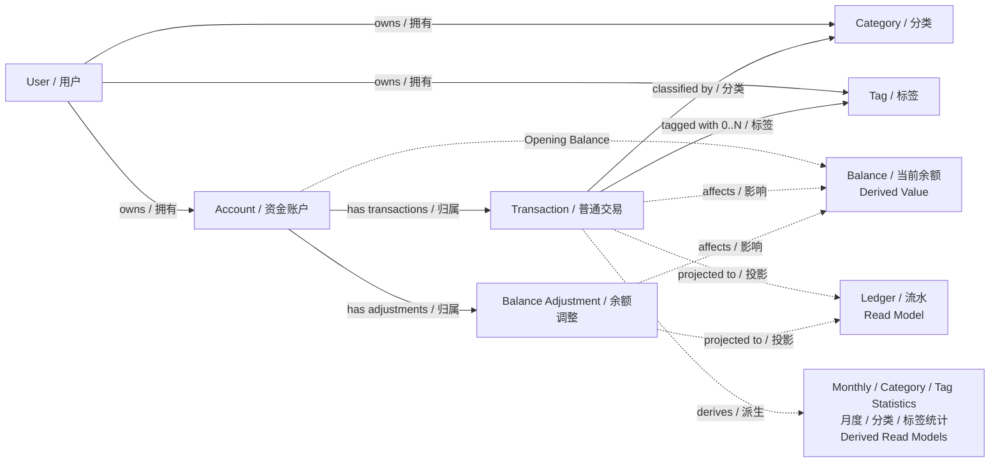

# 记账软件 v0.1 · Domain Model

> 文档状态：**Confirmed / Domain Baseline**  
> 前置基线：`v0.1-product-ui-freeze.md`、`v0.1-architecture-context.md` 已完成 Review  
> 需求优先级：**CR-002 > CR-001 > v0.1 正式产品需求**  
> 本文目标：建立稳定的业务领域模型、业务不变量与一致性边界。  
> 本文不包含：数据库表、API、ORM、Java/Spring Boot 实现、认证技术方案、部署方案或正式系统架构。

---

## 1. Domain Overview / 领域概览

v0.1 的核心业务不是“保存几张记账表”，而是维护以下业务事实及其关系：

1. **用户 User** 拥有自己的记账数据；
2. **资金账户 Account** 表示资金所在位置，v0.1 每个用户只有一个“微信”账户；
3. **普通交易 Transaction** 表示收入或支出业务事实；
4. **分类 Category** 用于表达普通交易的业务归类；
5. **标签 Tag** 用于提供可多选的横向标记；
6. **余额调整 Balance Adjustment** 用固定差额修正账户当前余额，但不是收入或支出；
7. **余额 Balance** 是由账户起始余额、普通交易和余额调整共同推导出的业务结果；
8. **月度统计 Monthly Statistics**、分类统计 Category Statistics、标签统计 Tag Statistics 均由已保存业务记录按既定规则派生，不是独立的源业务事实。

本轮推荐采用一个**简单领域模型**：

- `User`、`Account`、`Transaction`、`Category`、`Tag`、`BalanceAdjustment` 均具有独立业务身份，属于 Entity；
- `Balance` 属于 **Derived Value / Calculation Result（派生值 / 计算结果）**，不作为独立业务实体；
- `Transaction` 与 `BalanceAdjustment` 是两个不同的领域对象，不强行合并成一个“大而全”的交易实体；
- 为了流水查询，可以引入概念级的 **Ledger Entry / 流水项** 作为统一读取语义，但它不要求成为独立持久化实体，也不要求二者共享继承体系；
- `Money / 金额`、`Transaction Type / 交易类型`、`Record Time / 业务记录时间` 等适合作为 Value Object 或受约束值来表达业务语义；
- v0.1 不需要为了形式完整引入 Event Sourcing、CQRS、Saga、复杂 Domain Event 体系。

---

# 2. Ubiquitous Language / 领域词典

后续需求、架构、代码和测试优先沿用以下中英文术语。

| 中文术语 | English | 领域含义 |
|---|---|---|
| 用户 | User | 数据归属主体；v0.1 使用预先创建的用户名密码账号 |
| 用户标识 | User ID | 标识数据归属用户的业务身份 |
| 资金账户 | Account | 资金所在位置；v0.1 每个用户一个固定“微信”账户 |
| 账户标识 | Account ID | 唯一标识一个资金账户 |
| 账户创建时间 | Account Creation Time | 账户开始允许记录业务时间的下界 |
| 起始余额 | Opening Balance | 账户初始化时的余额基准，不计入收支统计 |
| 当前余额 | Current Balance / Balance | 起始余额与全部已保存普通交易、余额调整共同推导的当前结果 |
| 金额 | Money / Amount | 精确到分的有符号金额 |
| 普通交易 | Transaction | 收入或支出业务记录 |
| 交易标识 | Transaction ID | 唯一标识一笔普通交易 |
| 交易类型 | Transaction Type | Income 或 Expense；与金额正负号相互独立 |
| 收入 | Income | 一种普通交易业务类型 |
| 支出 | Expense | 一种普通交易业务类型 |
| 交易名称 | Transaction Name | 普通交易的选填展示名称；为空时列表回退显示分类名称 |
| 分类 | Category | 普通交易的唯一业务分类，区分收入/支出，最多两级 |
| 一级分类 | Parent / Level-1 Category | 分类第一层；有子分类时只作为分组 |
| 二级分类 | Child / Level-2 Category | 可直接关联交易的二级分类 |
| 可记账分类 | Bookable Category | 可以直接与普通交易关联的分类 |
| 标签 | Tag | 区分收入/支出的无层级横向标记，可多选 |
| 交易标签关联 | Transaction-Tag Association | 已保存交易与已存在标签之间的关联事实 |
| 余额调整 | Balance Adjustment | 用固定差额修正当前余额的独立业务记录，不属于收入或支出 |
| 目标余额 | Target Balance | 用户创建余额调整时表达的操作意图，不等同于最终保存的业务事实 |
| 调整金额 / 调整差额 | Adjustment Amount / Adjustment Delta | `目标余额 - 提交时当前余额`；最终保存并持续影响余额的固定差额 |
| 业务记录时间 | Business Record Time / Record Time | 用户选择的时间；决定自然月归属和流水主排序 |
| 交易时间 | Transaction Time | 普通交易的业务记录时间 |
| 调整时间 | Adjustment Time | 余额调整的业务记录时间 |
| 首次保存时间 | First Saved Time | 记录第一次成功保存的时点语义；编辑不得改变 |
| 首次保存顺序 | First Save Order / Creation Order | 同一业务秒内稳定区分保存先后的不可变排序语义 |
| 更新时间 | Updated Time | 若技术实现需要，可记录最后修改时点；不是当前产品核心业务规则 |
| 自然月 | Calendar Month | 按北京时间从业务记录时间推导的统计月份 |
| 流水 | Ledger | 某账户按业务时间及首次保存顺序展示的普通交易与余额调整集合 |
| 流水项 | Ledger Entry | 统一读取普通交易与余额调整时的概念性表示，不等同于独立领域实体 |
| 月度总计 | Monthly Summary | 某自然月收入、支出、结余、交易笔数的派生结果 |
| 分类统计 | Category Statistics | 某自然月按分类聚合普通交易的派生结果 |
| 标签统计 | Tag Statistics | 某自然月按标签聚合普通交易的派生结果，允许同一交易出现在多个标签中 |
| 无标签分组 | Untagged Group | 对无标签普通交易进行统计时的派生分组 |
| 数据归属 | Ownership | 某账户、交易、分类、标签属于哪个用户 |
| 业务不变量 | Domain Invariant | 无论如何实现都必须始终成立的业务规则 |
| 一致性边界 | Consistency Boundary | 一次业务操作中必须共同成功或共同失败的业务事实范围 |
| 聚合 | Aggregate | 用于维护一组强一致业务规则的领域边界 |
| 聚合根 | Aggregate Root | 聚合对外修改入口 |
| 派生值 | Derived Value | 可由源业务事实重新计算得到的业务结果 |

---

# 3. Core Domain Objects / 核心领域对象

## 3.1 User / 用户

### 推荐身份

**Entity / 独立身份实体。**

在记账领域中，User 最重要的作用是表达业务数据归属、形成用户隔离边界。用户名密码、会话、凭证等认证实现属于后续架构问题，不在本轮扩展成完整身份认证模型。

### 主要职责

- 标识业务数据属于哪个用户；
- 作为同名分类、标签唯一性规则的用户作用域。

### 核心不变量

- 用户只能操作属于自己的业务数据；
- 不同用户的数据不能因为名称相同而互相影响；
- 分类、标签等唯一性规则均需在正确的用户作用域内判断。

## 3.2 Account / 资金账户

### 推荐身份

**Entity + Aggregate Root（独立聚合根）。**

理由：

- Account 有稳定身份和生命周期；
- 起始余额和创建时间属于账户自身业务事实；
- 当前 Balance 虽与账户相关，但推荐视为基于账户及其记录得到的派生结果；
- 不应把一个账户下所有历史 Transaction 全部放进一个巨型聚合，否则聚合会随流水无限增长。

### 主要职责

- 表达资金所在位置；
- 保存账户自身核心事实：起始余额、创建时间、币种、归属用户；
- 为普通交易与余额调整提供业务归属上下文。

### 核心不变量

- v0.1 每个用户只有一个名为“微信”的资金账户；
- 币种固定为人民币；
- 起始余额可正、可零、可负，精确到分；
- 账户初始化后不允许通过“直接改起始余额”修正余额；
- 与账户关联的业务记录时间不能早于账户创建时间。

> “每用户只有一个微信账户”是 v0.1 产品范围，不等于未来领域模型永远只能有一个账户。

## 3.3 Transaction / 普通交易

### 推荐身份

**Entity + Aggregate Root（独立聚合根）。**

一笔 Transaction 是稳定的业务事实，有自己的身份和生命周期，支持新增、编辑、删除。

### 主要职责

表达一笔已经确认的收入或支出业务事实。

### 核心不变量

1. 必须属于一个 User 和一个 Account；
2. `Transaction Type` 必须是 Income 或 Expense；
3. Amount 必须非 0，精确到分，可正可负；
4. 金额正负不能改变 Transaction Type；
5. 必须关联一个可记账 Category；
6. Category 必须与 Transaction Type 匹配；
7. 可关联 0..N 个 Tag；
8. 同一 Transaction 不能重复关联同一个 Tag；
9. 所有关联 Tag 必须与 Transaction Type 匹配；
10. Transaction Name 可空、允许重名；
11. Business Record Time 必须存在，且不得早于 Account Creation Time；
12. Business Record Time 可位于过去、现在或未来；
13. 已成功保存后 Transaction Type 不可修改；
14. 编辑只能修改当前类型允许修改的名称、金额、分类、标签、业务时间和备注；
15. First Save Order / First Saved Time 在普通编辑时不可改变；
16. 删除 Transaction 后，这笔业务事实不再对 Balance 和 Statistics 产生影响。

### 关于名称为空

“名称为空时列表显示分类名称”更接近**展示规则 / Read Model 规则**，不是要求把分类名称复制成 Transaction Name。

因此：

- Transaction Name 仍然保持空；
- 展示层根据当前关联分类得到 fallback display name。

## 3.4 Category / 分类

### 推荐身份

**Entity。v0.1 可视为独立、固定参考数据聚合。**

Category 有稳定业务身份，交易关联的是具体分类身份，而不是只保存一个分类文字。

### 主要职责

- 表达收入或支出交易的业务归类；
- 提供一级 / 二级分类层级；
- 决定某分类是否可以直接用于记账。

### 核心不变量

1. Category 属于一个 User；
2. Category 区分 Income / Expense；
3. 最多两级；
4. 有子分类的一级分类不可直接记账；
5. 无子分类的一级分类可以直接记账；
6. 二级分类可以直接记账；
7. 同一用户一级分类名称全局唯一；
8. 同一父分类下二级分类名称唯一；
9. 不同父分类下允许同名二级分类；
10. v0.1 分类固定，不提供用户管理生命周期。

“利息 / Interest”是收入侧可直接记账的一级分类。

## 3.5 Tag / 标签

### 推荐身份

**Entity + 独立生命周期。**

Tag 不属于某一笔 Transaction 的内部值对象，因为需求已经明确：

- Tag 可以先独立创建；
- 即使当前交易随后取消，Tag 仍存在；
- Tag 后续可被其他 Transaction 使用。

### 核心不变量

1. Tag 属于一个 User；
2. Tag 类型为 Income 或 Expense；
3. Tag 不支持层级；
4. 同一用户下 Tag Name 全局唯一，收入/支出之间也不能重名；
5. 名称去除首尾空白后不得为空；
6. Transaction 只能关联类型匹配的 Tag；
7. 创建 Tag 成功后，其生命周期独立于当前 Transaction。

## 3.6 BalanceAdjustment / 余额调整

### 推荐身份

**Entity + Aggregate Root（独立聚合根）。**

BalanceAdjustment 是独立业务记录，而不是普通 Transaction 的一个特殊 subtype。

### 核心不变量

1. 必须属于一个 User 和 Account；
2. Adjustment Amount 必须非 0；
3. Adjustment Amount 可正可负；
4. Adjustment Amount 精确到分；
5. 创建时：`Adjustment Amount = Target Balance - Current Balance at Commit`；
6. Target Balance 可以正、零或负；
7. 如果 Target Balance 等于提交时 Current Balance，则不创建记录；
8. 创建完成后，真正持续存在的业务事实是 **Adjustment Amount**，而不是“账户永远等于 Target Balance”；
9. BalanceAdjustment 立即影响 Current Balance；
10. BalanceAdjustment 不属于 Income / Expense；
11. 不关联 Category；
12. 不关联 Tag；
13. 不进入收入、支出、分类和标签统计；
14. Business Record Time 可为过去、现在或未来，但不得早于 Account Creation Time；
15. 历史 Business Record Time 只影响流水归属和排序，不改变差额计算基准；
16. 已保存 BalanceAdjustment 不允许编辑；
17. 删除后，其固定差额不再参与 Balance。

## 3.7 Balance / 当前余额

### 推荐身份

**Derived Value / Calculation Result（派生值 / 计算结果）。**

Balance 在领域语义上不是一个独立“业务事件”，也没有独立生命周期。

定义：

**Current Balance = Opening Balance + Income Amount Sum − Expense Amount Sum + Balance Adjustment Amount Sum**

所有已保存记录都参与当前 Balance，包括业务记录时间位于未来的记录。

### 领域层结论

- Balance 属于 Account 的业务状态语义；
- 但其真相来源是 Opening Balance + 已保存普通交易 + 已保存余额调整；
- “是否为了性能在存储层冗余保存 balance”是后续 Architecture Decision，不能反向改变这里的领域定义。

---

# 4. Balance Model Analysis / Balance 模型分析

## Option A：Balance 作为独立业务实体

### 优点
- 表面上容易理解“Account 有一个当前余额对象”。

### 缺点
- 容易形成两个真相来源：历史记录与 Balance Entity；
- 修改 / 删除历史交易时需要额外同步；
- 当前产品没有要求 Balance 拥有独立身份。

### 与当前需求匹配情况
一般。

## Option B：Balance 作为 Account 内部持久状态

### 优点
- 读取概念直观。

### 缺点
- 容易把领域定义与技术优化混在一起；
- 是否持久化属于后续技术决策。

### 与当前需求匹配情况
可以实现，但领域阶段无需固化。

## Option C：Balance 作为派生值

### 优点
- 与正式余额公式完全一致；
- 真相来源清楚；
- 修改 / 删除语义自然；
- 不提前承诺任何存储实现。

### 缺点
- 技术设计仍需评估查询与并发成本；
- Balance Adjustment 创建时需要在一致业务视图中得到提交时 Current Balance。

### 与当前需求匹配情况
**最高。**

### Recommended Domain Model
采用 **Option C：Balance = Derived Value**。

后续即使技术架构决定缓存或持久化 Balance，也应视为派生状态 / 优化状态，其正确性仍应能由源业务事实解释和验证。

---

# 5. Transaction vs BalanceAdjustment / 普通交易与余额调整

## Option A：一个统一 Transaction，大量 type 分支

### 优点
- 流水查询概念表面统一。

### 缺点
- BalanceAdjustment 会产生大量“不适用字段”；
- 编辑能力、统计规则、创建规则差异明显；
- 容易形成大量 `if type == ...` 的贫血大实体。

### 与当前需求匹配情况
可以实现，但模型清晰度较差。

## Option B：Transaction 与 BalanceAdjustment 独立

### 优点
- 各自业务规则清楚；
- 不会为 BalanceAdjustment 填充无意义字段；
- 编辑、统计和生命周期差异自然表达；
- 与产品术语一致。

### 缺点
- 流水查询需要组合两类记录。

### 与当前需求匹配情况
**最高。**

## Option C：抽象父领域实体 LedgerEntry，再继承两种记录

### 优点
- 能显式表达共同的账户、时间、排序语义。

### 缺点
- 当前共同业务行为有限；
- 容易为了面向对象形式引入不必要继承。

### 与当前需求匹配情况
中等。

### Recommended Domain Model

采用 **Option B**：

- `Transaction` 与 `BalanceAdjustment` 为两个独立领域对象；
- `Ledger Entry / 流水项` 只作为查询与展示时的概念性统一读取语义；
- 暂不建立领域实体继承关系。

---

# 6. Tag Lifecycle / 标签生命周期

**Tag 与 Transaction 不属于同一个生命周期。**

### CreateTag / 创建标签
是一个独立领域操作。创建成功后 Tag 已成为业务事实，当前 Transaction 是否最终保存不影响它存在。

### SaveTransaction / 保存交易
处理 Transaction 本身以及它与已存在 Tag 的关联。

Transaction 保存失败或用户取消：
- 不创建 Transaction；
- 不创建 Transaction-Tag Association；
- 已独立创建成功的 Tag 不回滚。

### 编辑交易
- 原 Transaction 与原 Tag Association 在保存前保持有效；
- 编辑中创建新 Tag，新 Tag 立即独立成立；
- 表单里的 Tag 选择变化只属于待提交意图；
- EditTransaction 成功后新的关联替换原关联；
- 放弃编辑则原关联不变，新建 Tag 自身仍保留。

---

# 7. Transaction Consistency Boundary / 普通交易一致性边界

## 7.1 Source Facts / 源业务事实

普通交易真正形成或修改的业务事实：

- Transaction；
- Transaction 对 Category 的关联；
- Transaction 对 Tag 的关联集合。

Category 和 Tag 本身不是随着 Transaction 保存而创建或修改的同生命周期对象。

## 7.2 Derived Results / 派生结果

以下结果由源业务事实推导：

- Current Balance；
- Monthly Summary；
- Category Statistics；
- Tag Statistics；
- Ledger 展示结果。

因此领域层不要求这些派生结果必须各自成为独立可写状态。

### CreateTransaction
必须保证 Transaction 与最终 Category / Tag Association 作为一个完整业务结果成功，不能出现“交易保存了，但部分标签关联没保存”。

### EditTransaction
必须保证原 Transaction 更新与最终关联集合形成完整结果；类型和 First Save Order 不变；整体失败时原业务事实保持原样。

### DeleteTransaction
删除后 Transaction 及其关联失效；Tag、Category 自身继续存在；Balance 和 Statistics 的派生结果相应恢复。

---

# 8. Time Model / 时间模型

## 8.1 Business Record Time / 业务记录时间
产品明确要求。用于自然月归属和流水第一排序键。

规则：
- 精确到秒；
- 默认当前时间；
- 不得早于 Account Creation Time；
- 可以为未来；
- 普通交易允许编辑；
- BalanceAdjustment 创建时选择，之后不可编辑。

## 8.2 First Saved Time / 首次保存时间
产品明确存在的首次保存语义，普通编辑不得改变。

## 8.3 First Save Order / 首次保存顺序
由同秒排序规则直接推导出的领域排序语义：

- 首次成功保存后不可改变；
- 同一业务秒内，后首次保存的记录在前；
- 编辑不改变它。

具体技术实现留待后续。

## 8.4 Updated Time / 更新时间

Updated Time 不属于当前核心业务语义，而是可选的 **Technical Metadata / 技术元数据**。

如果正式实现需要，它可以用于未来的增量数据同步、BI / ETL 抽取、运维排查或技术审计；但这些用途不构成 v0.1 新的产品需求。

Updated Time：
- 不参与余额计算；
- 不参与自然月归属；
- 不参与业务统计口径；
- 不参与流水排序；
- 不能替代 First Saved Time / First Save Order。

## 8.5 Calendar Month / 自然月
由 Business Record Time 按北京时间推导，不是用户独立填写的业务事实。

---

# 9. Stable Ordering / 稳定排序语义

领域排序规则：

```text
1. Business Record Time DESC
2. First Save Order DESC
```

若修改 Business Record Time，记录按新的业务时间重新进入主排序位置；若修改后与其他记录同秒，仍使用原有 First Save Order 作为次排序依据。

本轮不决定 First Save Order 通过何种字段或机制实现。

---

# 10. Balance Adjustment Consistency / 余额调整一致性语义

## 10.1 Target Balance / 目标余额
Target Balance 是用户输入的**操作意图**：

> “我希望此刻把当前账户余额调整到 X。”

它不意味着历史某时点余额等于 X，也不意味着账户今后锁定为 X。

## 10.2 Adjustment Amount / 调整差额
真正长期保存的业务事实是：

```text
Adjustment Amount = Target Balance - Current Balance at Commit
```

一旦创建成功，Adjustment Amount 固定，后续补录、修改或删除其他 Transaction 不重新计算它。

## 10.3 领域一致性要求
用于计算 Adjustment Amount 的 Current Balance 与最终创建 BalanceAdjustment 的业务提交必须处于同一个一致决策点。

如果页面打开时余额 100，但提交前余额已变成 95，不能继续以 100 计算。

锁、版本号、事务隔离等技术方案留给下一阶段。

## 10.4 历史时间
历史 Record Time 只改变流水归属与排序，不触发历史余额回溯。

---

# 11. Statistics Domain Position / 统计的领域定位

## Option A：统计作为独立核心状态
优点：查询概念直接。  
缺点：新增、修改、删除都要维护多份状态，当前没有规模驱动。

## Option B：统计作为源记录的派生 Read Model
优点：真相来源唯一、修改删除自然、与当前范围匹配。  
缺点：未来规模变大时需要技术优化。

### Recommended Domain Model
采用 **Option B**：

- Monthly Summary、Category Statistics、Tag Statistics 均属于 **Derived Read Model / 派生读取模型**；
- 业务口径属于领域规则；
- 存储与计算方式属于后续 Architecture Decision。

固定统计规则：
- BalanceAdjustment 不参与普通收支统计；
- Monthly Summary 只统计 Transaction；
- Category Statistics 按 Transaction Type 分开；
- 一级分类汇总与二级明细不能重复叠加；
- 多 Tag Transaction 完整计入每个 Tag；
- Tag 统计不能相加当作整体总收支；
- Overall Summary 必须按 Transaction 去重；
- 无 Tag Transaction 进入 Untagged Group。

---

# 12. Aggregate / Consistency Boundary / 聚合与一致性边界

## User Aggregate / 用户聚合
承担用户身份生命周期。记账领域主要通过 `User ID` 引用，认证凭证细节留待后续。

## Account Aggregate / 资金账户聚合
包含 Account 自身身份、User Ownership、Opening Balance、Account Creation Time、Currency、Account Name。

不把全部 Transaction 和 BalanceAdjustment 装入 Account 聚合内部。

## Transaction Aggregate / 普通交易聚合
Aggregate Root：`Transaction`

一致性操作中确定 Transaction 自身、Category reference、Tag association set、Business Record Time、immutable First Save Order 语义。

Transaction 引用 Category / Tag 身份，不拥有其生命周期。

## Tag Aggregate / 标签聚合
Aggregate Root：`Tag`。独立创建、独立存在。

## Category Aggregate / 分类聚合
v0.1 为固定参考领域数据，有身份和父子关系，但本期没有用户驱动的增删改生命周期。

## BalanceAdjustment Aggregate / 余额调整聚合
Aggregate Root：`BalanceAdjustment`。创建时依赖提交时 Current Balance，成功后保存固定 Adjustment Amount，不允许修改。

## 为什么不采用 Account 超级聚合
不推荐把所有 Transaction、Tag、Category、BalanceAdjustment 全部放入 Account。原因是生命周期不同、流水持续增长、会人为放大一致性边界，且当前业务规则并不要求。

### 一致性边界摘要

| 操作 | 必须作为一个业务结果成立 | 可独立生命周期 |
|---|---|---|
| Create Transaction | Transaction + Category reference + 最终 Tag association set | Tag、Category |
| Edit Transaction | Transaction 更新 + 最终 Category / Tag associations | 新创建 Tag |
| Delete Transaction | Transaction 及 associations 一起失效 | Tag、Category |
| Create Tag | Tag 自身 | 当前未保存 Transaction |
| Create Balance Adjustment | 提交时 Balance 语义 + 新 Adjustment 固定差额 | 历史 Transaction |
| Delete Balance Adjustment | Adjustment 失效 | 其他记录 |

Balance 和各类 Statistics 属于派生结果，不要求作为源状态同时写入。

---

# 13. Conceptual Domain Relationship / 概念级领域关系图



---

# 14. Core Domain Operations / 核心领域操作

## CreateTransaction / 创建普通交易
**意图**：在指定 Account 下记录收入或支出。  
**前置条件**：用户有权操作；类型、金额、分类、标签、时间全部合法。  
**成功结果**：Transaction、Category reference、Tag associations 成立；First Save Order 首次确定；Balance/Statistics 派生结果改变。  
**不变量**：不能部分保存，金额正负不改变类型，未来交易立即影响 Balance。

## EditTransaction / 编辑普通交易
**意图**：修改已有普通交易。  
**前置条件**：用户有权操作；类型保持不变；修改后的金额、分类、标签、时间合法。  
**成功结果**：更新原 Transaction，不新建第二笔；最终关联替换原关联；First Save Order 不变；派生结果更新。

## DeleteTransaction / 删除普通交易
**意图**：撤销一笔普通交易。  
**成功结果**：Transaction 与关联失效；Tag/Category 自身保留；Balance/Statistics 撤销该交易影响。

## CreateTag / 创建标签
**意图**：创建可供当前和后续交易使用的新 Tag。  
**成功结果**：Tag 独立保存，当前 Transaction 后续取消也不影响它。

## CreateBalanceAdjustment / 创建余额调整
**意图**：把提交时 Current Balance 调整到 Target Balance。  
**规则**：目标等于当前余额时不创建；否则保存固定 Adjustment Amount。  
**结果**：立即影响 Balance，不影响普通收支统计。

## DeleteBalanceAdjustment / 删除余额调整
**意图**：撤销一次余额调整。  
**结果**：该差额不再参与 Balance；普通收支统计不变。

## QueryMonthlyLedger / 查询月度流水
**结果规则**：Transaction + BalanceAdjustment；按 Business Record Time DESC、First Save Order DESC；Current Balance 独立于查询月份。

## QueryMonthlyStatistics / 查询月度统计
**结果规则**：只基于 Transaction；排除 BalanceAdjustment；遵守分类、标签、去重和正负金额规则。

---

# 15. Candidate Decisions and Recommendations / 候选方案与推荐摘要

| 问题 | 推荐领域结论 | 暂不决定的技术问题 |
|---|---|---|
| Balance 是什么 | Derived Value / 派生值 | 是否冗余存储、缓存、SQL 计算 |
| Transaction 与 BalanceAdjustment | 两个独立领域对象 | 最终持久化结构、统一查询技术 |
| Ledger Entry | Read Model 概念，不作为核心 Entity | 查询实现 |
| Tag 生命周期 | 独立于 Transaction | 存储及事务技术 |
| Statistics | Derived Read Model | 实时查询、汇总、缓存 |
| 时间排序 | Business Time + immutable First Save Order | 字段类型、sequence、timestamp、ID |
| Account 边界 | 独立 Aggregate，不包含全部历史流水 | 仓储与加载策略 |
| Transaction 边界 | 独立 Aggregate Root，关联 Category / Tag 身份 | 事务技术与 ORM 映射 |
| BalanceAdjustment 边界 | 独立 Aggregate Root | 并发控制技术 |

---

# 16. Domain Decisions Resolved / 已确认领域决策

以下领域结论已经完成人工 Review，并作为 **Domain Baseline** 生效：

1. Balance / 当前余额是 Derived Value，不是独立 Entity；
2. Transaction / 普通交易与 BalanceAdjustment / 余额调整是两个独立领域对象；
3. Ledger Entry / 流水项只作为统一查询语义，不要求成为核心领域实体或继承父类；
4. Tag / 标签拥有独立生命周期，不属于 Transaction 聚合内部对象；v0.1 已支持随用随加，改名、删除、合并和独立管理页面留到后续版本；
5. CreateTag 是独立领域操作；Tag 可先于 Transaction 保存且后续交易失败/取消不回滚；但 Transaction 本身、Category Reference 与最终 Transaction-Tag Association Set 必须共同形成一个完整业务结果；
6. v0.1 Category 是预先存在的固定参考数据；创建 Transaction 时只能引用已有合法 Category，不允许在记账过程中创建 Category；Category 与 Tag 自身均不随 Transaction 删除而删除；
7. Balance、Monthly Summary、Category Statistics、Tag Statistics 都属于派生结果，而不是当前核心源业务状态；
8. Business Record Time / Transaction Time 表达用户选择的业务发生时间，允许延迟记账；First Saved Time / First Save Order 表达记录首次进入系统的系统时点与顺序，两者语义必须分离；
9. Updated Time 若存在只作为 Technical Metadata，可用于未来增量同步、BI / ETL、运维排查或技术审计；它不参与余额、月份、业务统计和流水排序，也不能替代 First Saved Time / First Save Order；
10. Target Balance 是创建 BalanceAdjustment 时的操作意图，Adjustment Amount 才是最终保存的固定业务事实；
11. BalanceAdjustment 必须基于提交时 Current Balance 计算差额；并发技术方案留给下一阶段；
12. Account 不作为包含全部流水的超级聚合；
13. v0.1 使用简单聚合模型即可，不引入 Event Sourcing、CQRS、Saga 等复杂模式。

---

# 17. Architecture Decisions Remaining / 后续仍需解决的架构问题

1. 客户端与服务端边界、整体应用形态；
2. 是否采用独立后端及具体服务形态；
3. Java / Spring Boot 等应用技术栈；
4. 正式持久化数据库类型与产品；
5. Balance 的技术计算 / 冗余存储策略；
6. Monthly / Category / Tag Statistics 的技术查询或汇总策略；
7. Transaction 与 BalanceAdjustment 的正式持久化模型；
8. Tag Association 的持久化与事务实现；
9. 幂等 / 重复提交的具体保障方式；
10. BalanceAdjustment 提交时的并发控制方式；
11. Business Record Time、First Saved Time、First Save Order 的正式数据表示及排序兜底；
12. 认证、会话 / 凭证和 User Context 的实现方式；
13. 数据隔离在服务与存储层的落实方式；
14. 数据库唯一约束如何配合用户作用域；
15. 真实数据启用前的备份、恢复及验证方案；
16. 日志、错误追踪、监控等最小运行能力；
17. 总体应用架构复杂度；
18. 部署形态。

---

# 18. Product Questions / 产品问题

本轮领域建模**没有发现新的、阻塞性的产品问题**。

仍保留既有 Open UX Decision：

> 跨月份保存普通交易后，返回流水页停留原月份还是自动跳转到交易所属月份。

该问题不影响领域模型。

---

# 19. Domain Modeling Conclusion / 领域建模结论

推荐结构：

```text
User / 用户
  │
  ├── Account / 资金账户
  │      ├── Transaction / 普通交易
  │      └── BalanceAdjustment / 余额调整
  │
  ├── Category / 分类
  └── Tag / 标签

Transaction
  ├── exactly one Category
  └── zero to many Tags

Balance
  = Opening Balance
  + Income Transactions
  - Expense Transactions
  + Balance Adjustments

Ledger
  = Transactions + Balance Adjustments
  ordered by Business Record Time + First Save Order

Monthly / Category / Tag Statistics
  = Derived Read Models from Transactions
```

核心原则：

> **少保存“重复真相”，把普通交易、余额调整、分类、标签等稳定业务事实建模清楚；Balance 与 Statistics 保持明确的派生语义。具体如何高效计算和持久化，留给下一阶段 Architecture Decision。**

---

# 20. Next Step / 下一阶段

Domain Model 已完成人工 Review，并冻结为 **Confirmed / Domain Baseline**。

下一阶段进入：

**Architecture Options / Architecture Decision**

届时再正式比较：

- 应用整体形态；
- 技术栈；
- 持久化；
- Balance / Statistics 技术策略；
- 幂等；
- 并发；
- 认证；
- 备份恢复；
- 部署复杂度。

本文件不提前回答这些问题。
