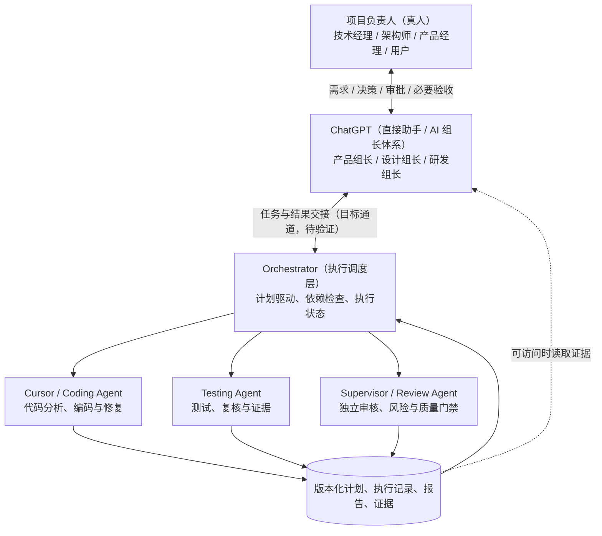
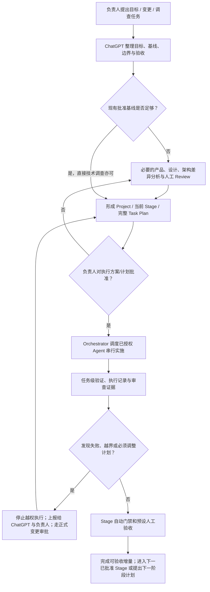

# 04丨记账软件｜AI 研发组织与协作治理基线

- 文档版本：v1.6 · 正式版
- 前一正式版本：v1.5（Approved，现由 v1.6 接替作为项目治理主基线）
- 初稿日期：2026-10-19
- v1.0 正式批准日期：2026-10-21
- v1.1 编制日期：2026-10-21
- v1.1 正式批准日期：2026-10-21
- v1.2 编制日期：2026-10-21
- v1.2 正式批准日期：2026-10-21
- v1.3 编制及正式批准日期：2026-10-22
- v1.4 编制及正式批准日期：2026-10-23
- v1.5 编制及正式批准日期：2026-10-23
- v1.6 编制及正式批准日期：2026-10-23
- v1.0 审批依据：项目负责人在先前对话中审阅 v0.1 后明确要求转为正式版。
- v1.1 审批依据：项目负责人审阅会话复用审阅稿及治理 v1.1 / Project Instructions v1.1 差异后，明确回复“均同意，批准。你生成新文件吧”。
- v1.2 审批依据：项目负责人审阅《治理基线 v1.2 · 补充审阅稿》后明确表示“v1.2的治理基线，已经审核通过，内容我看过了，没有问题”。
- v1.3 审批依据：项目负责人审阅《正式工程资料入库与临时交接规则 · 治理补充审阅稿 v1.3》后明确回复“同意，你更新正式版，我放入项目中”。
- v1.4 审批依据：负责人统一审阅四份文件后明确表示“文档都可以审阅通过。你可以标注为已通过，提供新文档，并且说明应该放到哪个地方”；并明确不立即更换 Chat、仅在确有必要时换 Chat，本地临时目录在功能完成及代码合并后集中清理。
- v1.5 审批依据：负责人审阅《跨 Chat 项目组长职责继承与接续验收规范 · Review v0.1》及当前状态 v0.4 后明确表示“前边两个文档已经审批通过，没有问题。生成对应文档，我放到项目的公用空间中”；本次仅把批准的职责接续操作规范整合入正式治理，不增加权限。
- **v1.6 获批依据**：负责人于 2026-10-23 审阅《项目组长自主决策授权与风险分级治理修订 Review v1.6》后明确表示“同意，你修改文档”，并就 S2 两个子里程碑给予单独试点指示。
- **v1.6 获批审阅原件**：`bookkeeping-governance-decision-delegation-review-v1.6.md`；SHA-256 `735f7c95c9926be98858cca86cdd3afceeab237393cd2fb4b6584cd15c4eb8a3`。该原件保持原字节，不以修改 Review/Pending 正文替代独立批准记录。
- v1.5 获批审阅原件：`bookkeeping-cross-chat-lead-handoff-protocol-review-v0.1.md`；SHA-256：`5466857cb12dd4dd54ba21f086b9f9b4b8af6e178b811cf691f34e07e5796671`；统一批准索引 `bookkeeping-2026-10-23-approval-index-v0.2.md` 另存。
- v1.4 获批审阅原件：`bookkeeping-governance-cross-chat-handoff-review-v1.4-r3.md`；SHA-256：`e6212df6f906bffdcdc18cbec54a93284d44527bc04bcb8819bdd5854f272b2b`；原件字节保留，批准事实见独立批准索引。
- 状态：**Approved / 正式治理基线**（批准事实成立；Project 文件与指令的实际替换须由用户完成，不能假称已自动更新）
- 用途：跨 Chat、跨 Agent、跨会话长期复用，避免因上下文丢失而重新制定组织和工程流程。
- 适用范围：本项目的产品、设计、技术审核、规划、实施、质量验证和交付；不限于当前 v1.0。
- 文档性质：**治理规范**，不是产品 PRD、架构方案或当前 Stage/Task Plan。

> **首要原则：换 Chat 不换组织、不换流程、不撤销已审批结论。** 对于既有规则有疑问时，先查项目基线与决策记录，再提出澄清；不得仅凭当前 Chat 可见内容不全便另起流程。

## 1. 组织与责任

### 1.1 组织关系

**注意：图中“ChatGPT ⇄ Orchestrator”与“执行证据回传 ChatGPT”是中长期目标机制，不代表技术联通已经完成，也不是记账软件交付的前置条件。** SDK/POC-2 的真实 Agent 执行与审核已有历史试点；当前 Chat 如不能直接操作用户 Mac 上的 Cursor，应如实说明。是否继续投入自动联通，应根据现实瓶颈和投入产出另行判断，不能假称全链路已实现。

### 1.2 职责与权限

| 角色 | 必须承担 | 不得擅自承担 |
|---|---|---|
| **真人项目负责人** | 决定目标、冻结产品/架构边界、Stage 初版完整 Task Plan、人工里程碑及其交付范围；批准 §4.8 保留的高风险行为；执行约定人工验收和 GitHub 网页端主干合并 | **不是** AI 之间的日常消息中转站，不需审批已授权里程碑内部的普通任务顺序调整 |
| **ChatGPT 产品组长** | 需求研究、PRD、未冻结交互细节优化并在里程碑 Review 前说明变动 | 改变冻结业务规则、已批准 UI Freeze 或 Stage 功能范围 |
| **ChatGPT 设计组长** | UX/UI、原型、交互验收、差异分析；未冻结细节可先优化并记录 | 绕过已确认产品与 UI 基线自行改变行为 |
| **ChatGPT 研发组长** | 组织技术调查、初版完整计划编制；初版获批后可在里程碑范围内自主调整内部任务/顺序并版本化；组织执行、证据 Review、质量门禁和风险汇报 | 未经审批改变 Stage 或人工 Gate 范围/验收、越权决定 DDL/真实数据迁移/新基础设施，或声称未核验的测试事实 |
| **Cursor / Coding Agent** | 读取本地真实仓库、技术调查、开发自测；仅在授权后编码与修复 | 自行增加需求、重排已批准任务、擅自提交变更范围、代替产品/架构审批 |
| **Testing Agent** | 任务级测试、回归、复现、结果与证据记录 | 偷换验收标准、把未测视为 PASS |
| **Supervisor / Review Agent** | 交叉审查代码、证据、方案及执行结果；指出问题及风险 | 代替负责人作范围或重大技术决策 |
| **Orchestrator** | 严格依据批准计划安排依赖、Agent、检查、重试、暂停与恢复，保存可追溯状态 | 自行修改需求/计划/审批结果，或绕过门禁 |

**ChatGPT 既可直接干活，也可调度其他 Agent；使用哪个 Agent 按当前可用能力与任务需要决定。** 不应机械地把 ChatGPT 能直接完成的工作转交 Cursor；同样不应强迫 ChatGPT 在无法读取代码时自行猜测源码。

## 2. 端到端协作流程

解释：这是**正常开发的标准路径**，而不是每个只读审查任务都需要新建一整套 Project/Stage。已批准的需求、UI、架构等成果应复用；只读代码审核采用限定范围的任务授权与只读执行，不构成“已授权开发”。

## 3. 计划、审批与执行不变量（继承既有试运行原则）

1. **Project Plan** 规定项目目标、版本范围与技术约束；不一次性详列所有未来 Stage。
2. **Stage Plan** 定义一个可独立验收的产品或技术交付增量；明确成果、测试门禁和是否需要真人业务验收。
3. **Stage 初版完整 Task Plan** 在执行前列明全部计划内任务、顺序、依赖、产物、验收和人工里程碑，由 ChatGPT 编制并由负责人批准，审批绑定原件版本和 SHA。
4. **初版获批之后**，在不改变 Stage 顺序、人工里程碑、已冻结功能范围和验收口径的前提下，组长可自主调整任务的顺序、拆合、依赖及范围内必要修复/测试；每次调整形成可追溯版本、Diff、SHA 和组长决策记录。不允许跨人工 Gate、越过独立门禁或偷换需求。**变更功能范围、人工 Gate、验收标准、Stage 顺序和 §4.8 受保留控制事项，须负责人先批后实施。**
5. **Execution Record 独立于 Plan。** 执行日志、证据、已完成项、重试和失败记录可由 Agent 自动及时更新；不把日常日志更新混同为重新审批 Plan。
6. **同一项目同一时间最多一个 Coding Agent 执行编码任务。** Coding、Testing、Supervisor 按调度次序工作；不得擅自建立并行开发队伍。
7. **任务级验证 + Stage 级质量门禁。** Stage Plan 已指定人工验收的必须进行；无需人工验收且自动验证达标者，可继续既已审批的后续阶段（不是自动批准一个新 Stage）。
8. 测试失败时可在初版已批准的功能与安全边界内，由组长批准必要实现任务调整、复核与有限重试；触及 Stage/里程碑范围、必备 Gate 或 §4.8 受保留事项时停止该部分并上报，不得让 Agent 自行扩需求。
9. Stage 验收完成不自动等于生产发布批准；发布权限和上线前合规要求另行控制。
10. **产品真实交付优先。** 可按需复用既有 Cursor SDK/POC-2，但不把完善自动化调度平台作为当前业务开发的硬性前置条件；仅在真实瓶颈和投入产出合理时渐进投入，不无故重建 Agent 平台。

## 4. AI 之间通信与人工介入

### 4.1 预期常态（v1.2 交付优先与低成本人工接力）

- **产品交付优先，自动化按投入产出选择。** ChatGPT 负责组织任务、综合审查和提出决策建议；优先由 Agent 自主完成能够完成的工程工作，避免把建设调度通道变成主线任务。
- 项目负责人原则上把目标、决策和授权交给 ChatGPT，由 ChatGPT 组织 Cursor/Coding、Testing 与独立 Supervisor；不要求负责人日常直接管理多个 Agent。
- Orchestrator/自动交接通道**在已验证可用且经济合理时**负责任务与证据流转；未打通时，可使用已批准任务范围内的轻量人工交接。
- 为当前功能交付，允许负责人**偶尔**通过按功能复用的 Cursor 会话传递任务/结果，或将单次脚本粘贴到终端；当这一方式成本明显低于建设或修复自动通道时，应优先采用，不得为了减少一两次消息传递反复开展平台建设或无界 SDK 研究。
- ChatGPT 在能访问材料时独立复核证据与 Agent 报告，并向负责人汇报结论；负责人不承担高频、长期的 AI 消息中转。自动化调度和回传保留为中长期演进方向，**不构成当前业务交付的强制门禁**。

### 4.2 必须请求人工的典型条件与常设授权边界（v1.2 补充）

- 已冻结产品规则、Stage/人工里程碑交付范围和验收、关键架构边界需要变更。
- Project/Stage 和**初版完整 Task Plan** 的审批；后续变更是否仍需负责人审批依 §3/§4.8 的授权分类判断，不逐一申请里程碑内部的实施顺序调整。
- Stage Plan 约定的真人验收；需要真实微信小程序、设备或实际用户操作的场景。
- 超出当前 Agent/执行环境授权的外部认证、费用、部署或生产操作；首次引入新的中间件/基础设施类别及正式数据库 Schema/真实历史数据迁移。
- **高风险行为须事前由负责人判断。** 包括生产/真实业务数据写入、提权、访问未授权目录或敏感凭据、不可逆删除以及无法保留恢复点的破坏性操作；例外仅限 §4.8 明示、受控、可恢复的独立开发库行为，以及既有 `release/v1.0` 分支有界非强制 Push。不得凭 `ai-runner` 常设工作区授权推定已经许可。
- 无法自动克服的执行通道阻断、安全/隐私风险或影响不可接受的异常。

**已获批 Stage / 当前版本 Task 内的常规操作**：在授权隔离工作区内，Agent 可按组长版本化调整后的合法 Task 范围自主执行普通文件读写、编译、测试和保留恢复点的本地 Git 操作，无须逐命令申请；不得突破初版获批的功能范围、人工/独立 Gate 或 §4.8 安全红线。

**通道受限的处理**：说明“哪个环节不可达、影响什么、已验证到哪里”；允许成本更低的偶发人工消息接力或一次性终端脚本，不把负责人变成高频长期中转员，也不擅自宣称已经打通自动通道。

### 4.3 Cursor Agent 会话复用与独立审核边界（v1.1 正式条款）

**默认按功能、产品版本或工作领域组织 Cursor 会话，而不是每个 Task ID 都必须新开会话。** Task/Run 是受授权、可关闭并留存必要证据的执行单位；Cursor Chat 是工作上下文容器。一个会话可以连续承接同一领域中多个**各自已获批**的任务，前一任务完成不自动授予下一任务权限。

- **可复用**：同一领域、职责一致、上下文清晰、不会影响独立性时，可以沿用既有 Cursor 会话；不应机械要求“一 Task 一会话”。
- **必须隔离**：参与某项变更编码的 Agent，不得在同一会话中充当该变更的独立 Testing/Supervisor；负责形成某项调查结论的会话，不应再作为要求独立于该调查的最终 Reviewer 会话。是否独立取决于真实参与情况，而非仅凭会话名称或所属 Project。
- **需要新会话的其他情形**：上下文过长、历史指令污染、角色/权限转换造成冲突，或无法可靠核对当前代码、任务和证据。
- **持续不变的门禁**：每次任务必须能追溯获批初版计划与组长合法的内部调整记录、版本/SHA、终态和必要证据；独立审核必须重新读取本轮材料，不以旧会话记忆替代实际复核。单项目单 Coding Agent 串行等既有规则不变。
- **项目分组与工作目录**：允许 Cursor 内在同一 `bookkeeping` 项目下管理相关工作会话；本地 SDK 工程与记账软件业务仓库的实际工作路径由获批 Task 确定，项目名称不等于可越权操作的目录。

**与任务计划的关系**：会话复用规则不直接改变任何已批准 Task Plan，也不追认失败的质量门禁。独立审核必须由未参与被审实现或调查工作的会话完成。具体在途任务和门禁状态以最新获批计划及执行记录为准，不写死在长期治理条款中。

### 4.4 正式工程资料入库与临时交接（v1.3 正式条款）

**基本原则：长期、持续有效且已批准的工程资料，优先纳入对应业务 Git 仓库 `docs/`，供执行 Agent 就近读取和核验；临时材料继续采用成本较低的低频交接。** ChatGPT Project 保留跨 Chat 必须读取的现行文件或索引。**本段为 v1.3 的文档治理历史原则，不是对 v1.6 §4.8 已批准的任务自治及有界远端 Push 授权的否定；文档归档本身仍不能额外扩权。**

| 资料类型 | 首选位置 / 处理方式 | 边界 |
|---|---|---|
| 正式 PRD、UI Freeze、架构决策、已批准 Stage / Task Plan | 按类别归档到业务仓库 `docs/product/`、`docs/architecture/`、`docs/implementation/`；正式治理及必要审批索引可放在 `docs/governance/`（必要时建立） | 优先沿用合理的现存路径；**实际入库必须在已批准的任务范围与本地 Git 授权内执行**，不能将本条当作立即增补开发任务的授权 |
| 获批计划原件与审批证据 | **保持批准时原文件原字节**，另设批准索引/记录，注明版本、批准依据、SHA-256、适用范围及替代关系 | 不得擅自修改 Review/Pending 原件标题或内容后仍沿用旧 SHA-256；负责人后续批准事实以独立记录体现 |
| 临时 ZIP、一次性脚本、运行 Manifest/日志、调查快照 | 按需低频临时交接或保留在有权限的执行证据位置 | 不是正式基线来源，不要求全部入 Git；不得携带敏感凭据或个人资料 |
| ChatGPT Project 共享资料 | 保留**现行治理基线、当前项目状态、核心正式产品/UI 文件以及当前获批计划**的可访问副本或索引 | Git 承担工程执行版本的文档归档；Project 承担跨 Chat 读取。未自动同步时必须分别标明已同步/待同步，不虚称二者实时一致 |
| 测试/执行结果 | 简洁的重要结论和证据引用可入 `docs/implementation/` | 不强制纳入大体积原始日志、运行期临时包或个人环境信息 |

**历史在途 Task 兼容（记录 v1.3 制定当时的限制，S1 现已 CLOSED）**：v1.3 不回溯中断、追加任务或修改当时正在执行的 S1-T03，也不改变当时已批准的 S1 Task 顺序与校验值。S1-T03 完成后，先核对现有批准任务是否覆盖资料入库；**若未授权，须按现行 Plan 变更审批另行批准，或待独立文档维护任务获批后执行**，不得擅自插入 S1-T04。不得因为文档治理获得批准就自行 `push`、创建 PR、改生产资料或访问越界目录。

**验证要求**：在未来实际获批的资料归档任务完成时，核验 Git 中能读取目标正式文件、原件与批准 SHA-256 一致、执行 Agent 可以识别当前有效计划和审批状态、Project 的核心文件仍可跨 Chat 获取且版本不冲突、临时文件未被误当正式基线、执行中的 Stage/Task 顺序及证据未被改变。未经实际验证不得报告“已入库”或“已同步”。

### 4.5 跨 Chat 交接资料与交接时点（v1.4 正式条款）

### 4.5.1 唯一短入口（最小必备）

每个项目版本/活跃 Stage 在 ChatGPT Project 中应有**一份明确标识“现行”的《项目状态与跨 Chat 交接记录》**（简称「当前状态」）。可以是原文副本，也可以是可靠可访问的索引；不强制复制全部正式资料。

当前状态至少包含以下 9 类信息：

1. **身份及时间**：项目名称、目标产品版本、状态文件版本/形成时间、事实截点（As-of）、编制来源。明确状态记录不是开发授权。
2. **现行治理**：获批治理版本及可访问文件/索引；Project Instructions 实际更新状态（已核实 / 待更新 / 未核实）。
3. **现行产品与设计**：正式 PRD、UI Freeze、重要架构决策的文件名/版本/批准状态，必要时提供 SHA 和所在位置；继承旧基线而非仅列最新稿。
4. **批准的执行计划**：当前 Project/Stage/完整 Task Plan **原件版本、SHA-256、独立批准索引及被替代版本**。Review/Pending 原件仍保留原字节；审批以独立批准记录为准。
5. **进度与门禁**：当前 Stage、Task、PASS/FAIL/BLOCKED/NOT STARTED，区分 Coding 自测、Testing、Supervisor 和人工 Gate；记录最新报告、Run/证据标识及日期。
6. **代码及环境事实**：仓库身份、隔离工作区与负责人本地仓库是否区分、分支/提交/未提交改动、UAT worktree 是否完成；**未核实项必须标明**，不假称已读最新源码或 GitHub 状态。敏感本机路径只在需要时通过有权限执行通道使用，不必传播到 Project。
7. **当前阻断与风险**：P0～P3 的已知结论、未完成的数据库/设备/真实模型验证、是否要求停止后续任务；高风险授权边界。
8. **唯一可执行下一步**：谁执行、所依据的已批准 Task、下一项输出/验收、是否需要负责人决策、所需最小文件或证据；不可把建议写成已授权动作。
9. **资料可访问性与一致性**：Project 副本、Git `docs/`、临时 ZIP/脚本/证据的实际可取得性；最后一次验证时间；差异/缺失项和历史状态文件替代关系。

「当前状态」只放事实和当前决定，不复制长篇 PRD、全量源码、几十页日志、临时凭据；最多为正在进行的一项任务附上精确证据入口和下一步指令。若证据与状态冲突，不能修改原审批文件迁就状态记录，应重新核对来源。

### 4.5.2 旧 Chat 的准备时点（低频、事件驱动）

**A. 必须准备交接的场景（在可能的情况下于旧 Chat 结束前完成）：**
- 用户提出更换 Chat，或旧 Chat 发现上下文过长、已经影响准确接续；**在切换前**形成/刷新当前状态，并告知新 Chat 读取入口。
- 正式获批 Plan 被变更/替代、重要审批或产品/架构结论变更后，最迟在下一 Chat 接续或下一任务使用新授权前更新状态索引。
- Stage Gate 完成、被 BLOCKED、恢复后重启，或已批准 Stage 进入人工验收/Stage CLOSED 时，更新相应终态和下一步。
- **每个独立验收功能增量结束时强制完成轻量结项整理**（通常等同 Stage；若正式计划把一个功能独立定义为交付增量，也适用）。即使新 Chat 未立即创建，也须提供下一 Chat 可接续的状态与材料索引；该动作不等于自动发布或立项下一 Stage。

**B. 日常不需要重复生成交接包的场景：**
- 每完成一条命令、每个常规 Task 进度更新、每次测试日志产生、每个 ZIP 上传。正常更新执行日志或证据索引即可；只有影响接续判断的信息改变才刷新短状态。
- 不是每次切 Chat 都重复生成治理、PRD、UI、架构或批准计划原件。正式文件已可可靠访问时，只更新指针及当前事实。

**C. 旧 Chat 临时不可用时：**由新 Chat 依据 Project 现有状态、批准记录和可访问 Git/执行证据恢复，明确“最后已验证时间”和缺口，不能让用户重述全部历史；仅请求无法从现有资料取得的最低限度输入。

### 4.5.3 新 Chat 启动动作与验收标准

新 Chat 应主动：

1. 读取**现行治理 + 当前状态短入口**；先辨识过时记录，确保当前状态的 As-of 不早于已掌握的关键审批/任务结果。
2. 顺着索引读取现行 PRD、UI、架构和**Task Plan 原件及其独立批准记录**，核对文件 SHA；不把正文 `Review/Pending` 覆盖后续真实批准事实。
3. 若用户要求继续工程任务，再核验最近一级执行门禁和所需证据（Coding/Testing/Supervisor/人工）；不能把摘要转述当作完整实测。
4. 明确区分 **已确认事实 / 观察记录 / 待审提案 / 未验证能力**；对 repo 工作树、Agent 通道、数据库状态不作无来源的实时推断。
5. 汇报一句可操作结论：`可直接继续` / `可继续但有明确缺口` / `BLOCKED`，指出下一动作与授权；除确有必要，不重新组织已批准流程。

**交接合格定义**：新 Chat 能回答“现在做哪一个 Stage/Task、依据哪份已批 Plan+SHA、上一个 Gate 结论、代码在哪、下一步谁做什么、有什么操作不能做”，即为交接成功；不要求完整理解每一次历史讨论。

### 4.5.4 三类资料的职责边界（沿用 v1.3）

| 类型 | 承担什么 | 最少需要保留 | 不要求 |
|---|---|---|---|
| ChatGPT Project 当前状态 | 跨 Chat 快速定位 | 唯一现行状态文件、获批基线/计划的可访问副本或索引 | 每次全量上传运行日志 |
| 业务 Git `docs/` | Agent 执行时的正式工程版本 | 有授权后归档 PRD/UI/架构/获批计划原件及独立审批索引，验证 SHA | 未授权先改仓库、自动 Git↔Project 同步 |
| 任务执行证据区/临时交接 | 真实运行证据及偶发 Cursor↔ChatGPT 接力 | Run/commit/branch、简要结论、必要清单/哈希，关键时按需提供 ZIP | 所有一次性脚本都必须作为正式基线入库 |

不得在交接文件或临时包中传播真实数据库凭据、个人资料、令牌或敏感环境文件。

### 4.5.5 每个功能增量完成后的结项资料契约（v1.4 正式条款）

**适用触发点**：负责人完成该功能/Stage 约定的人工验收并明确终态、或已批准计划允许在自动 Stage Gate 后完成独立功能增量时。若仍存在 P0/P1 或关键产品/UI Gate 未满足，必须标注 `BLOCKED/有条件待审批`；不能借整理文档宣称 CLOSED。正式关闭或带遗留项关闭仍以已批准 Stage Plan/获批变更为准。

**由即将结束此功能的 Chat 主动产出或更新的最小集合（不要求每项各建一个新大文件）：**

| 资料角色 | 必要内容 | 放置与生命周期 |
|---|---|---|
| **现行状态短入口** | 最新 Stage/Task、完成/门禁/下一步、获批版本和 SHA、Git HEAD/分支/工作区、尚未核实项 | Project 保持**唯一现行**版本；旧版标历史；有权限时在 Git `docs/` 维护可访问索引 |
| **功能/Stage 结项记录** | 交付范围、负责人 UAT 结论与可核验覆盖、Testing/Supervisor 证据、代码提交、已知遗留与排除项、正式关闭或 BLOCKED 的依据 | Git `docs/implementation/` 优先，需获批文档维护授权；Project 保留关键摘要或可访问副本 |
| **待办/偏差登记** | 每项 ID、P0–P3、实际根因/影响、延期理由、必须修复前的门禁、候选归属 Stage、负责人决定、是否已纳入**获批**后续 Task | 可维护在现有 Backlog/状态文件，不强制另建新表；不得把建议误写为已批准实施 |
| **正式基线索引** | 治理/PRD/UI/架构/获批 Stage/Task 原件、独立批准记录、SHA、替代关系、Project 和 Git 可读性 | 正式材料原字节不动；Git 归档仍须单独获批范围；不能虚构 Project↔Git 同步 |
| **下一 Chat 启动说明** | 一段短引导：先读状态→批准链→本阶段结项/遗留→下一阶段需要决策的事项 | 可作为现行状态的一节，无须单独新增第五份文件 |

**完成定义**：交接入口足以让新的 Chat 无需重新定义项目，准确恢复“已交付内容、未完成问题、现行正式 Plan、证据边界、代码真实位置、下一项待决定内容”；至少一次核实文件可访问、SHA/批准链，记录尚未核实 Git/Project 状态。若交付档案未实际入 Git/Project，只能标为“本 Chat 已生成、尚待入库”，不能报告已同步。不得在 Project/交接包中留下口令或数据库配置。

**不新增仪式化负担**：每个小 Task 完成仍记执行日志即可；本条针对独立交付增量/Stage。可以复用同一个状态文件、同一本 Backlog 和阶段结项文件的已有模板，不反复全量生成 PRD、UI、治理和大量运行日志。

### 4.5.6 不为形式而切换 Chat（本次批准补充）

功能或 Stage 完成时，即使负责人没有更换 Chat 的打算，也按 §4.5.5 维护结项资料与唯一现行状态入口。**不因文件已整理就强制新开 Chat**；优先在当前 Chat 连续工作，确实受到上下文长度、准确性或职责冲突影响，或负责人决定切换时，才执行换 Chat。旧 Chat 不因后续工作尚未全部结束而延误已完成增量的档案整理。

### 4.6 人工验收前的 Git 代码交接（v1.4 正式条款）

- **触发条件**：Stage/Task 已按批准计划达到人工 Gate 前置条件，且用户的本地项目尚无法读取待验收的真实代码。
- **默认方式（负责人视角）**：在现有工具权限范围内，由 Cursor/已授权 Agent 将已通过门禁的代码及必要 Git 历史安全地交付到负责人既有本地 Git 仓库的**独立 UAT 分支**。负责人在需要人工验收时，**优先继续使用日常项目目录并在其中检出 UAT 分支**，而不是被迫打开另一个 `bookkeeping-uat-*` 目录。小程序开发者工具和本地后端从该目录使用待验收代码；验收并不自动合并到 `main`。
- **Agent 的内部隔离不变**：Coding/Testing/Review 仍可在 `ai-runner` 隔离仓库或独立 worktree 工作。Git worktree 是同一 Git 仓库的另一工作树，并非另一套远端仓库；这里调整的是**负责人日常入口和交接完成标准**，而非否定 Git worktree 技术。
- **切换前的安全前提**：先核实原目录属于预期仓库、现有分支及工作树状态；不得覆盖未提交修改，不能以 `reset --hard`、`clean -fd`、强制 checkout 或自动无授权 stash 代替保护。对于已经被其他 worktree 占用的 UAT 分支，由执行 Agent 在安全、可恢复、且相关工作树无待保留修改时，释放占用（例如安全移除已完成用途的 worktree 或令其退出该分支）后再切换；不可对正在使用的工作区强制操作。记录切换前分支/HEAD，必要时验收结束后可安全返回，**不修改 `main` 的提交历史**。
- **例外处理**：如果负责人原目录有未提交修改或正在进行的重要工作，无法安全切换，应明确说明阻断及最小可行替代，由负责人选择继续使用临时 worktree 或先处理原目录状态；不得未经确认改变默认工作区。
- **可恢复保障**：验证源/目标仓库身份、计划 SHA、审核证据、文件完整性、原工作区脏文件；保留恢复点、源提交与交接结果。具体传输可采用现有的 local Git bundle/合适 Git 对象交接，**不规定每次必须新建 bundle 或 worktree**；操作不得无故覆盖负责人现有工作树。
- **授权边界**：常规可恢复的本地 Git 操作，在已有任务范围和本地仓库授权内自主完成，不需逐命令审批；**本条本身不授予对用户其他目录、未授权目标仓库、远端 push/PR/merge、生产/外部部署、不可逆删除或提权的权限**。当前 S1 已有负责人针对本地验收分支的明确授权，具体执行仍须核验结果；后续 Stage 以各自获批计划和范围为准。
- **Gate 不变**：本地 UAT 交付 PASS ≠ T08 人工验收 PASS ≠ Stage CLOSED；后续 main 合并、PR 和生产发布仍独立授权。
- **失败处理**：缺少目录权限、源/目标不一致、无法保留工作区或需要越权时 STOP，一次性汇报阻断与 1–2 个有界备选方案；不开展无界环境调试或未经批准的同步平台开发。

### 4.7 跨 Chat 项目组长岗位接任与持续履职（v1.5 正式条款）

**更换 Chat = 同一岗位的组长接任，不是新立项或重设指挥链。** 新 Chat 依照 Project Instructions 与现行治理，继续承担产品、设计、研发组长的任务组织、证据 Review、质量门禁检查、风险处置、待办追踪、人员职责协调和向负责人汇报的责任；不是仅依据旧 Chat 摘要复述进度。负责人继续按需要在 Cursor 客户端发送任务或手动启动脚本；这属于低频执行接力，不要求 ChatGPT 直接控制负责人的 Mac，也不允许把负责人转成多个 Agent 的日常消息中转员。

**静态岗位与动态在办责任分别继承：**

| 继承对象 | 现行依据及接任要求 |
|---|---|
| 静态岗位/指挥边界 | 现行治理及 Project Instructions；负责人审批，ChatGPT 组织，Cursor 受权编码，Testing/Supervisor 实质独立，一个 Coding Agent 串行。各 Task 不继承前一 Task 权限 |
| 当前批准与执行 | 唯一现行状态、计划原件+SHA/独立批准记录、最新 Gate 与证据。区分**已批准、已下达、已执行、待回执、已复核、未验证** |
| 正在运行/待回执 Agent 工作 | 状态文件记录最后下达指令、执行方、任务范围、当前等待、报告索引、下一次接收/审核动作；无法读取活跃 Cursor 会话时不得假称已完成 |
| Git/PR/环境 | 代码与测试证据位置、分支/HEAD、PR 编号/URL/状态、可获取性、最新验证时间、尚未获授权操作；报告源与真实实时校验分开 |
| 后续管理债务 | Backlog 的 ID、级别、延期理由、最迟修复 Gate、候选 Stage 但未获批的 Task，以及人工验收、归档和目录整理的未完成责任 |

**唯一现行状态中的工作队列**至少说明：当前在推进什么、最后发给哪个 Agent 的指令、待回执或待决定什么、ChatGPT 接下来要 Review 什么、下一行动责任人、完成条件、仍需负责人批准什么。以事件驱动方式刷新；一般 Task 进度更新仍放执行日志，不额外每次生成全量交接文档。功能/Stage 结束依 §4.5.5 维护四类结项资料，不强制开新 Chat。动态状态随新证据更新，已批准原件及 SHA 不因快照更新被改写。

**旧 Chat 的退出责任：**确需换 Chat 时，先以最近的批准/事实/证据核对唯一当前状态，标注事实截止、尚未返回的 Agent 指令、责任队列、最近 Gate、代码/PR 位置与权限；检查现行治理、PRD/UI/架构、获批 Plan+批准索引、结项及必要测试证据可访问。不确定的资料明确标注未核实，给出最少量新 Chat 启动说明；无需把全部临时脚本、ZIP 或完整聊天转储入 Project。

**新 Chat 六项接任核对：**首次接续必须能基于资料回答：①组长职责/各 Agent 权限；②项目当前 Stage/Task/最近 Gate/遗留；③批准与执行终态（含 Git 外部操作）；④代码、PR、文档和证据在哪里且最后核实到哪；⑤下一步组织谁做什么及交付判定；⑥禁止擅自执行哪些事项。结论使用 `HANDOFF_READY`（六项有来源且可续办）、`HANDOFF_PARTIAL`（有明确缺口并在补齐）、`BLOCKED`（缺口确实阻断下一合法动作）。不得用旧摘要冒充 Git 实测，亦不得以“接任”自行授权新 Stage、push、PR、merge、部署或清理。

**证据验证：**在未来确需换 Chat 时对照已批准计划+原件 SHA、最近 Coding/Testing/Supervisor/UAT 证据、现行状态与 Git/PR 回执检查六项；无材料时先检索 Project/可靠 Git，再仅请负责人补充不可取得的最小信息。完整审阅依据与示例见 `bookkeeping-cross-chat-lead-handoff-protocol-v0.1-approved.md`；该参考文件不代替唯一当前状态。

### 4.8 项目组长自主决策授权、数据库分层与远端集成（v1.6 正式条款）

**本章取代与之冲突的 v1.5“任意 Plan 变更、每次远端 Push 均需审批”条款；其余高风险边界仍有效。** 授权仅对当前项目、初版获批 Stage/Task Plan 和明确指定的执行对象适用，不自动授予新 Stage 编码权限。

#### 4.8.1 决策归属：日常黑名单、保留审批白名单

- `DECIDE`：组长可决定，安排已授权 Cursor/Agent 实施，按需要记录任务版本和执行证据；适用于尚未冻结的设计细节、实现算法、既有技术栈内依赖选择、普通 API 和模块组织、范围内缺陷修复/测试补充、里程碑内 Task 顺序/拆合调整、受控本地 Git。
- `NOTIFY`：组长可先决定、后向负责人集中说明的事项：未冻结产品细节优化（须在所在里程碑 Review 前说明）、核心领域**内部技术组织**的重要调整（含前后差异、理由、影响），以及本章有界授权下完成的共享远端集成 Push（提交 SHA/证据/PR 状态）。不得以 NOTIFY 绕过已冻结业务语义变更。
- `APPROVE`：负责人必须事前明确批准：Project/Stage 首版完整 Task Plan、S2→S7 等已确定 Stage 顺序与人工里程碑功能/范围/验收变更、已冻结 PRD/UI/领域规则改变、新基础设施/服务类别（例如首次选择 Redis、MQ、ES）、重要架构或部署拓扑变更、正式数据库表/列/索引/关系/约束等 Schema 设计、额外已有业务数据迁移/回填、生产/真实个人数据操作、范围外敏感读取/提权/付费、不可逆行为、扩权与受保护主干操作。
- `STOP`：无法确定目标环境、数据性质、提交真实性、授权链、恢复点或独立审核要求时，停止有危险的部分，保留已完成的安全工作和证据，给出有限的待决策事项。

**Task Plan 修改授权**：组长可重排、拆合实施任务并批准自己的修订版，但必须标注初版负责人批准文件/SHA，记录新版本、Diff、原因、前置依赖和影响；不得削减原定功能或 Quality Gate，也不得把跨人工里程碑工作移入另一个里程碑。只读调查可以前置，但不能把“调查已做”视作已经批准编码。

#### 4.8.2 技术与数据库权限矩阵

| 对象 | 授权与约束 |
|---|---|
| 现有栈下的代码组织、普通依赖及版本选择 | 组长 `DECIDE`；新增 Redis/MQ 等**基础组件类别**本身必须 `APPROVE`，一旦批准使用，具体 SDK/客户端依赖与封装由组长决定。 |
| 核心领域内部对象职责、聚合/服务组织 | 组长 `DECIDE+NOTIFY`，附差异供负责人事后审核；已冻结业务规则、安全/租户隔离、余额派生、交易-标签一致性等改变必须 `APPROVE`。 |
| 正式数据库 Schema（建/改/删表、列、索引、约束和关系） | 所有环境的**正式设计**由负责人 `APPROVE`，必须提交具体 DDL/Migration、兼容性、预计锁影响及回退；不能因开发库可自主操作就自行批准正式结构。 |
| 额外已有业务数据迁移、批量回填/重算 | `APPROVE`；须说明目标库、数据规模、事务、锁影响、验证和恢复。 |
| 已识别、专用、非真实业务数据**开发库** | 可在获批 Stage 范围内自主做模拟数据 CRUD、可恢复重建、已批准 Schema 在开发库的演练以及仅用于探索的临时对象；有破坏风险操作须在执行前具备可用恢复脚本/快照、恢复验证与审计记录，目标 **RTO ≤10 分钟**。达不到可信恢复条件须降级安全操作或 `STOP`。 |
| 专用**测试库** | 比开发库更严格：仅白名单目标/脚本与可丢弃样例，执行自动化测试所必需的受控操作；不得默认 `Flyway.clean()` 或 DROP 未核实/共享实例。 |
| **生产库、真实个人数据、共享不可丢失数据** | 每次具体操作和执行环境须 `APPROVE`；不能从开发/测试授权继承；生产合并、部署和迁移仍独立。 |

**10 分钟恢复是目标而非保证**：先核实库的归属、非真实数据性质、备份/恢复脚本和影响范围，并在合适隔离环境实际演练恢复；恢复完成应验证 Schema、关键记录和最小应用读写。未知大表/锁表风险、无可用恢复点或带真实业务数据时不得直接试错。

#### 4.8.3 Git 分支与 PR

- 本地及隔离工作区的任务分支、可恢复提交、cherry-pick、受控 rebase 等常规操作由组长安排；不得覆盖负责人脏文件、破坏恢复点或擅自删除已使用的 worktree。
- **有界常设远端授权**：对当前仓库 `L-Hurricane/bookkeeping` 的既有 `release/v1.0`，组长可以在初版获批 Stage 范围内、必要 Testing/Supervisor Gate 通过及凭据安全核查后，组织**非强制 Push**并更新现有 Draft PR #2（指向 `main`），事后 `NOTIFY` 负责人文件差异、完整 SHA、门禁和 PR 状态。此许可不是创建新 PR/分支或修改 `main` 的许可，也不自动授权未批准的新 Stage 代码。GitHub App 最小权限与 `protect-main` 保持不变。
- 创建新的共享远端集成分支或 PR、修改 PR 基准分支、远端强推/删除/改分支规则、扩充 App 权限仍须 `APPROVE`；网络故障不得擅自采用未经审核的 Git API 对象重建等非常规远端发布路径。
- **受保护 `main` 的最终 Merge**：仅负责人在 GitHub 网页端决定和操作。Agent 不得合并、绕过保护、提前将 PR 从 Draft 改为可合并状态；Stage UAT PASS 不是 Merge/生产许可。

#### 4.8.4 质量、证据及 S2 有界试点

- 单 Coding Agent 串行、独立 Testing/Supervisor 和任何已经冻结的安全/人工 Gate 均不因放权减少。测试报告必须区分 `PASS / FAIL / BLOCKED / SKIPPED` 及未测范围；关键风险未解决不得伪称 PASS。
- **本次 S2 专项已获方向批准**：负责人指定两个子里程碑，M1 为真实功能+A+B-lite 启动/证据试点，拟由组长划定功能交付后交负责人确认，Gate 为独立自动 Testing/Supervisor PASS、可无强制人工 UAT；M2=S2 最终人工功能与流程 Gate。**S2 的具体业务范围及初版完整 Stage/Task Plan 仍须另行批准**；详情只保存在 S2 审阅/计划及唯一现行状态入口，本段仅记录本次范围性的专项授权依据。该双里程碑不是未来所有 Stage 的强制模板，不能用来提前编码或合并 main。

## 5. 跨 Chat 连续性与基线优先级

**v1.6 沿用并强化读取顺序：现行治理 → 项目当前状态（唯一短入口）→ 当前获批计划原件与独立批准索引 → 本次工作相关正式 PRD/UI/架构 → 最新门禁、代码和证据 → 下一步。** 若尚不需要更换 Chat，仍按功能/Stage 结项契约正常留档，不为交接目的强行另开会话。内容发生冲突时，以具有原件 SHA 和批准事实的较新资料为准。

新 Chat 启动时应当：

1. 优先读取本治理文档、当前项目状态/交接记录以及相关正式需求、UX/UI、架构和计划版本。
2. 复用**现行已批准**的流程及产品约束；不能因为没有看到旧对话就认定“从零设计”。
3. 明确区分：**已批准**、**已有试点证据**、**建议待批**、**能力尚未验证**；若历史说法冲突，标注证据出处并提请审定。
4. 对工作结果给出真实依据；无法访问 GitHub 或 Cursor 不代表可以假称做过源码审核。
5. 没有批准，不变更角色职责、审批层级、Agent 指挥链、Stage/Task 执行边界。
6. 当前版本状态不能永久写死在项目指令；单独使用项目状态文件追踪并持续更新。
7. 当工程计划或正式资料已在 Git 归档时，优先核验执行工作副本中的文件、批准记录与校验值；跨 Chat 使用 Project 中的相应可访问副本/索引。**不得把 Project 与 Git 之间尚未验证的同步当作已完成。**

建议引用优先级：**项目负责人最新明确批准的决定 > 相应正式治理/产品/设计基线 > 已批准变更记录 > 审阅稿与历史讨论建议**。不能把“已确认 UI”自动推论为“PRD 与开发计划已批准”。

## 6. 【强制硬规则】流程变化必须产出可归档文档

### 6.1 什么属于流程变化

包括但不限于：角色或指挥链变化、AI 间任务/结果交接方式、审批步骤或条件、计划管理、任务调度、测试/验收门禁、人工介入条件、失败恢复流程、自动化边界及持久化路径变化。

**只要涉及流程变化，不论大小，都必须先记录后执行；若执行中才发现差异，立即暂停越界部分、记录并报批。** 与需求、技术实现、UI 等普通内容变更分开管理。

### 6.2 ChatGPT 的交付义务

每次发现或建议流程修改时，ChatGPT **必须主动产生一份可下载、可加入当前 Project 的 Markdown 文档**（或现有正式治理文档的新版本），而不是只在聊天中说“已记住”。至少包含：

- 文档版本、日期、状态（审阅/已批准）和适用范围。
- 修改前流程、修改后流程、为什么变更。
- 角色和权限、审批/测试/交接等受影响的条款。
- 对现有 SDK/POC-2、工具通道、计划或在途 Stage 的兼容影响。
- 需要负责人决定的点和变更后验证方式。
- 变更记录（Change Log），标注前一版本及批准依据。

**生成审阅稿 ≠ 自动生效；只有负责人明确批准后，才能把修改标记为现行基线。** 如果工具无法产出文件，应明说并给出可直接保存的完整文稿，不得伪造文件链接。

### 6.3 用户与 ChatGPT 的动作边界

- ChatGPT 负责主动维护**可交付的更新文档**、差异摘要和建议。
- 用户负责在没有可用项目写入权限时，将更新版放入 ChatGPT Project 共享资料 / 项目指令；正式工程文件的 Git 归档由获得相应任务授权的执行方办理，不能要求负责人高频手动转交。
- **不要求用户每次新开 Chat 重新口述或粘贴旧流程。**
- 项目资料尚未更新时，先以前一正式版本执行；当前聊天的讨论稿不自动覆盖此前批准的基线。

## 7. 工程试点取向：以真实产品任务验证协作

**目标**：优先完成记账软件真实功能和已批准工程任务，在具体交付过程中验证“ChatGPT 组织 → Cursor/Agent 执行 → 必要 Testing/Supervisor 独立复核 → ChatGPT Review → 负责人关键决策/验收”的低成本闭环。**现阶段不以建成自动调度平台作为完成业务任务的前提。**

- 已有真实仓库及本机隔离账户等工程资产应优先复用；当前目录、分支、版本与工具能力均须在具体 Task 中核实，不作为长期不变事实写入治理规则。
- 已批准的只读调查任务遵循只读边界，不得未经新审批修改源码、配置、数据库、推送分支、创建 PR 或扩大工作范围；允许的非破坏性验证亦须明确影响和授权。
- 需要 Coding Agent 实施的业务改动，仍按现行 Project/Stage/Task 授权和独立验证门禁执行；不能因为负责人同意低成本人工交接或组长自治，就推定批准新 Stage 或放宽安全要求。
- 只有当消息调度或证据回传反复成为**高频、实质性的工程瓶颈**时，才单独提出自动化平台投入评估；其成本应与实际节省的人力和交付价值比较。
- 如自动通道不可用，可以由负责人偶发转发任务和结果或粘贴一次终端脚本。验证重点是实际功能成果、审核质量和人工协作成本，而不是平台能力清单。
- 本治理基线本身不构成新增编码、数据库变更、生产部署或任何具体 Task 的授权。

## 8. 已有事实、未验证点与范围限制

> 本节保留 v1.2 编制当时的历史证据快照，**不作为 v1.6 的实时项目进度**。其后 v1.0 PRD v0.2 已由负责人正式批准为 Product Baseline，UI Freeze 亦已有通过记录；代码状态、在途 S1-T03 与同步状况均须查最新项目状态及相应 Agent 证据。下表若与较新批准事实冲突，以较新事实为准。

| 事项 | 当前证据状态 | 本轮如何处理 |
|---|---|---|
| 已开展 v0.1 产品/UI/架构规划与 v1.0 需求及高保真 Review | 项目历史资料及当前会话可支持 | 继续复用，不重新从零设计 |
| SDK/POC-2 曾产生真实 Coding/Testing/Supervisor 相关执行成果与审批门禁试点 | 历史记录可支持基本结论；详细实现应复核 SDK/POC-2 实物 | 不重写底层，先查现状 |
| ChatGPT 自动向 Cursor 下达任务并自动接收最新报告 | **尚无本轮核验证据** | 本次试点首要验证项 |
| Cursor 目前 Git 仓库的实际代码状态 | **本轮尚未实读源码** | 不得把历史提交或历史报告作为现状 |
| Project Instructions 能否由当前 Chat 直接修改 | **当前无直接写入权限** | 由 ChatGPT 交付文档，用户手工放入项目 |
| v1.0 PRD 与 UI 的正式批准状态 | UI Review 已同意收口；PRD v0.2 内容曾逐项 Review，但实施授权应以正式批准状态为准 | 在排定开发 Stage 前核实，而不是默认获批 |

## 9. 版本与变更记录

| 版本 | 日期 | 变化 | 审批状态 |
|---|---|---|---|
| v0.1 | 2026-10-19 | 首次整合跨 Chat 协作、角色与审批治理、流程变更留档规则、v1.0 审核试点 | Review Draft |
| **v1.0** | **2026-10-21** | 经负责人 Review 正式定稿；保留 v0.1 的组织和流程边界，更新文档状态、批准记录与共享实施要求；未新增工程授权 | **Approved / 正式生效** |
| **v1.1** | **2026-10-21** | 新增 4.3：Cursor 会话按领域复用、Task 与 Chat 不强制一对一、独立审核职责隔离；其余审批和 Agent 调度机制不变 | **Approved / 由 v1.2 接替** |
| **v1.2** | **2026-10-21** | 产品交付优先，允许低频人工接力，调度平台按成本收益投入；明确高风险人工决策与隔离账户常设授权边界；不改 Task/Stage 审批和独立审核门禁 | **Approved / 由 v1.3 接替** |
| **v1.3** | **2026-10-22** | 正式工程资料优先 Git `docs/` 归档，原件 SHA 和批准事实分离；Project 保留跨 Chat 核心资料；临时交接低频化；不影响在途 S1-T03 或已批准计划与安全门禁 | **Approved / 由 v1.4 接替** |
| **v1.4** | **2026-10-23** | 跨 Chat 最小状态与交接时点、每功能/Stage 结项档案、负责人原目录 UAT 入口；不为交接强制换 Chat | **Approved / 由 v1.5 接替** |
| **v1.5** | **2026-10-23** | 在 v1.4 基础上增加项目组长岗位完整继承、当前 Agent 责任队列、六项接任核对；原审批门禁及安全权限不变 | **Approved / 由 v1.6 接替** |
| **v1.6** | **2026-10-23** | 将已批准的组长黑名单自治/高风险白名单审批、首版完整计划审批后里程碑内自主重排、开发/测试/生产库差异、10 分钟恢复目标、限定 release/v1.0 Push、M1/M2 试点纳入正式条款 | **Approved / 现行正式版** |

## 10. 生效、存放与后续维护

1. **本文件自负责人明确批准之日起作为当前有效的项目协作治理基线。** 后续发现不合理之处，按第 6 章生成变更审阅稿、待批准后再替换，不能在聊天里静默修改。
2. **v1.6 已由负责人依据 Review v1.6 明确批准。** 将本正式文件放入 ChatGPT Project「04丨记账软件」共享资料；验证 v1.6 可读取后，旧治理 v1.5 改作历史归档。将配套《ChatGPT Project Instructions v1.6》正文**整体替换**项目「项目指令」中的旧版本；未实际操作前不得声称 Project 设置已更新。
3. 已批准且持续有效的工程正式资料应优先按 §4.4 入库 `docs/`，由**已获对应授权的工程或文档维护任务**办理；**本文对既有 `release/v1.0` 的受控非强制 Push 单独授予常设范围性决策权（见 §4.8），但文档生成不构成具体新 Stage 编码或越界 Git 操作授权**。
4. 当前试点应以**真实产品交付及必要独立验证**衡量成效；自动调度、消息回传等能力仍须实证确认，未验证不得声称“已实现”，也不成为产品交付的额外强制前置条件。
5. 任何新 Chat 必须以本文件及其已批准后继版本为准，不能因为访问不到历史 Chat 就重建指挥链、审批机制或要求用户长期搬运 AI 消息。

